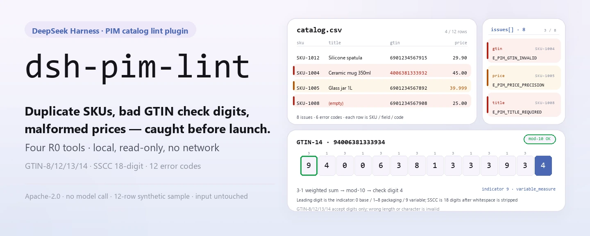
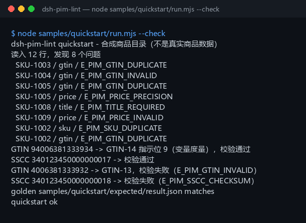

<div align="center">

<picture>
  <source media="(prefers-color-scheme: dark)" srcset="docs/assets/dsh-pim-lint-hero-en-dark.webp">
  
</picture>

# dsh-pim-lint

**Catch duplicate SKUs, broken GTIN check digits, and malformed prices before the catalog goes live.**

A local-only PIM catalog lint for DeepSeek Harness: reads a UTF-8 CSV, checks barcodes against GS1 rules, and reports every issue as SKU / field / error code; no network, no model call, no file changes.

[Install](#three-step-setup) · [Configuration](#configuration) · [FAQ](#faq) · [简体中文](README.md) · [English](README.en.md) · [Español](README.es.md) · [Português](README.pt.md) · [हिन्दी](README.hi.md)

[](LICENSE)
[](#compatibility)
[](https://www.npmjs.com/package/dsh-pim-lint)
[](https://github.com/PerryLink/dsh-pim-lint/actions/workflows/ci.yml)
[](#compatibility)

[](https://github.com/PerryLink/dsh-pim-lint/stargazers)
[](https://www.npmjs.com/package/dsh-pim-lint)
[](https://dshfind.com/plugins/PerryLink/dsh-pim-lint?ref=badge)
[](https://dsh.market/)
[](https://gitee.com/perrylink/dsh-plugins)

```sh
dsh plugin --profile <profile> add dsh-pim-lint
```

</div>

<sub>Community plugin, not affiliated with DeepSeek. Canonical repository: <https://github.com/PerryLink/dsh-pim-lint> (same-name repositories under other accounts are not affiliated; Gitee is an aggregate mirror). Status: alpha · public/synthetic validation only · not GA — no customer data or customer evidence, no production-readiness claim.</sub>

## What it is

The first mile of product master data: run a catalog CSV exported from a PIM / ERP / Excel through row-by-row checks — required columns, duplicate SKUs, duplicate GTINs, GTIN check digits, price precision, and negative prices — and get an issue list shaped as SKU / field / error code. `pim.validate` reads the whole table; `pim.gtin_check`, `pim.gtin_structure`, and `pim.sscc_check` check single barcodes and logistics units: GTINs are 8/12/13/14 digits, a GTIN-14's leading digit decodes to the packaging indicator and variable-measure flag per the GS1 rules, and an SSCC is 18 digits whose last digit is a mod-10 check digit. All four tools are read-only (R0) and compute on your machine; no network, no model call, no upload, and the original file is never modified. The project has been actively maintained since 2026-11-01, with new features, hardening, and fresh evidence landing continuously.

- **Good fit**: product master tables of tens to thousands of rows (UTF-8 CSV); a self-check of duplicate codes, barcodes, and price formats before a launch or a repricing.
- **Not a fit**: free-text product descriptions with no SKU or barcode; a direct connection to Tmall / JD / ERP (this package talks to no external system); replacing a GS1 registration or a channel review.

<picture>
  <source media="(prefers-color-scheme: dark)" srcset="docs/assets/dsh-pim-lint-flow-v5-dark.svg">
  
</picture>

## Three-step setup

1. **Install** (pick one channel):

   ```sh
   # npm channel (recommended, published releases)
   dsh plugin --profile <profile> add dsh-pim-lint
   # git channel (latest main; equivalent to git+https://github.com/PerryLink/dsh-pim-lint.git)
   dsh plugin --profile <profile> add github:PerryLink/dsh-pim-lint
   # tarball channel: pnpm pack in this repo, then
   dsh plugin --profile <profile> add ./dsh-pim-lint-<version>.tgz
   ```

2. **Minimal config** (the install command applies the bundle patch; copy this row when writing a profile by hand):

   ```yaml
   - insert:
       - id: dsh-pim-lint
         name: dsh-pim-lint
   ```

   There are no Schemastery config keys; everything adjustable is passed per tool call — see "Configuration".

3. **Verify it mounts**:

   ```sh
   dsh --profile <profile> --dump-config | grep dsh-pim-lint
   pnpm install --frozen-lockfile && pnpm build   # build before running the sample in-repo; the npm package already ships lib/
   node samples/quickstart/run.mjs --check        # should print quickstart ok
   ```

   The repo ships a synthetic sample (12 catalog rows + 2 barcode rows); run it once to see the whole chain. In a session you can also just say:

   > I have a product catalog CSV — find duplicate SKUs, GTIN check-digit problems, and price-precision issues, and list the issues by SKU.

**Uninstall**: `dsh plugin --profile <profile> remove dsh-pim-lint` (or remove the row from the profile patch).

<details>
<summary>Install from the DSH Desktop market</summary>

Every PerryLink plugin is listed in the built-in DSH Desktop market: **Market → Sources → Add source → paste** `https://perrylink-dsh-catalog.perrylink.workers.dev/catalog-source.json` **→ select**. Installation still requires the market's npm identity check and your confirmation.

</details>

## Core capabilities

- **Whole-table validation** — `pim.validate` reads an entire CSV at once: SKU required and unique (case-insensitive), title required, GTIN check digit and duplicate detection, and a price that must be non-negative with at most two decimals; it returns the row count and an issue array.
- **GTIN check digit** — `pim.gtin_check` validates GTIN-8/12/13/14 with the GS1 3/1 weighted mod-10 algorithm; spaces, letters, or a wrong digit count all come back invalid.
- **GTIN structure** — `pim.gtin_structure` reports the format (GTIN-8/12/13/14), the check result, the GTIN-14 packaging indicator (1–8 packaging level, 9 variable measure, 0 base unit), and the `variable_measure` flag.
- **SSCC check** — `pim.sscc_check` validates an 18-digit logistics unit code: whitespace is stripped first, then a format error (`E_PIM_SSCC_FORMAT`) and a wrong check digit (`E_PIM_SSCC_CHECKSUM`) stay distinct.
- **CSV structure guard** — a header-only file (`E_PIM_CSV_EMPTY`), a missing required column (`E_PIM_HEADER`), and a row whose cell count differs from the header (`E_PIM_CSV_ROW`) all throw, so the parser never guesses where a column sits.
- **Read-only, zero writes** — all four tools are R0: they do not write `$DSH_HOME`, do not write temp files, and do not touch your CSV; the issue list exists only in the terminal and the return value.

### Tool surface

Tool names are the stable API (kept in English to match the runtime output); descriptions are localized. All four tools are read-only, and there is no R1 write tool.

| Tool | Purpose | Risk |
|---|---|---|
| `pim.validate` | Validate `sku,title,gtin,price` CSV rows and return the row count and issue list | R0 |
| `pim.gtin_check` | Validate the GTIN-8/12/13/14 check digit | R0 |
| `pim.gtin_structure` | Decompose the GTIN format, packaging indicator, and variable-measure flag | R0 |
| `pim.sscc_check` | Validate an 18-digit SSCC and its mod-10 check digit | R0 |

### Input & output

Input:

- Format: UTF-8 CSV (with or without a BOM); the header must carry `sku,title,gtin,price` (case-insensitive, other columns allowed); `gtin` may be empty, and `price` uses two decimals.
- Size: keep a single table ≤ 5 MB (about 20k rows); there is no built-in hard limit — split by brand or category beyond that.
- Source: export from a PIM / ERP / Excel and save as CSV; the original file is never modified.
- Single-code checks: `pim.gtin_check` and `pim.gtin_structure` each take one GTIN string, and `pim.sscc_check` takes one SSCC string.

Output:

- Terminal issue list: every row reports `SKU / field / error code` (for example `SKU-1004 / gtin / E_PIM_GTIN_INVALID`), plus the GTIN structure and SSCC results.
- Nothing on disk: all four tools are read-only (R0), writing neither `$DSH_HOME` nor your CSV.
- Golden file: `samples/quickstart/expected/result.json`, produced by a real run.

### Examples

Copy this prompt verbatim (the demo prompt from `package.json`):

```text
我有一份商品目录 CSV，帮我查重复 SKU、GTIN 校验位和价格精度，把问题按 SKU 列出来。
```

Or run it yourself (a real run; the screenshot comes from this command):

```sh
node samples/quickstart/run.mjs --check
```



*12 synthetic catalog rows → 8 issues (3 duplicate GTINs, 1 bad check digit, 1 duplicate SKU, 1 missing title, 1 negative price, 1 price precision), plus one GTIN-14 variable-measure code and one bad SSCC; the golden file is `samples/quickstart/expected/result.json`, command and hashes in `screenshots.json`.*

Public/synthetic fixture acceptance: re-run `node scripts/acceptance.mjs`; the details are written to `ACCEPTANCE.csv` (quoted verbatim):

```csv
req_id,metric,threshold,actual,script,evidence_sha256,pass,source,counted
PIM-A01,valid catalog accepted,1/1,1,scripts/acceptance.mjs,8c73f1d813c01bb7b0aac5c1ad766c5556e838bc2427d498bf1d2824ccbe7058,true,public/synthetic,false
PIM-A02,duplicate/bad GTIN/price issues,3,4,scripts/acceptance.mjs,8c73f1d813c01bb7b0aac5c1ad766c5556e838bc2427d498bf1d2824ccbe7058,true,public/synthetic,false
PIM-A03,GTIN check digit,1/1,1,scripts/acceptance.mjs,8c73f1d813c01bb7b0aac5c1ad766c5556e838bc2427d498bf1d2824ccbe7058,true,public/synthetic,false
PIM-A04,GTIN-14 packaging indicator / variable measure,9,9,scripts/acceptance.mjs,8c73f1d813c01bb7b0aac5c1ad766c5556e838bc2427d498bf1d2824ccbe7058,true,public/synthetic,false
PIM-A05,duplicate GTIN reported,1,1,scripts/acceptance.mjs,8c73f1d813c01bb7b0aac5c1ad766c5556e838bc2427d498bf1d2824ccbe7058,true,public/synthetic,false
PIM-A06,over-precise price reported,1,1,scripts/acceptance.mjs,8c73f1d813c01bb7b0aac5c1ad766c5556e838bc2427d498bf1d2824ccbe7058,true,public/synthetic,false
PIM-A07,SSCC mod-10 check,1,1,scripts/acceptance.mjs,8c73f1d813c01bb7b0aac5c1ad766c5556e838bc2427d498bf1d2824ccbe7058,true,public/synthetic,false
PS1-QS01,quickstart 样例与金标一致,1/1,1,scripts/acceptance.mjs,8ec26f4f03fdfab708172b98887bbd9e836aa1bdc5df92a23453ee9e7e3b0285,true,synthetic/quickstart,true
```

*`pnpm gate` (`scripts/gate.mjs`) re-runs this acceptance, then checks every row for 9 columns, `pass=true`, a non-empty `actual` and `evidence_sha256`, and the presence of PS1-QS01. PIM rows are public/synthetic fixture checks (`counted=false`); PS1-QS01 is the bundled-sample replay (`counted=true`). Neither is a customer run, and no output is invented; per-row hashes are in [`ACCEPTANCE.csv`](ACCEPTANCE.csv).*

## Configuration

This plugin has no Schemastery `Config` keys — `cordis.patch.yml` only `insert`s one row (see "Three-step setup"). Everything adjustable is a per-call tool parameter:

| Parameter | Default | Meaning |
|---|---|---|
| `csv_text` (`pim.validate`) | none (required) | The whole catalog CSV as text; the header must carry `sku,title,gtin,price`, other columns are allowed, and a BOM is optional |
| `gtin` (`pim.gtin_check` / `pim.gtin_structure`) | none (required) | The barcode to check; only 8/12/13/14 digits are accepted |
| `sscc` (`pim.sscc_check`) | none (required) | An 18-digit logistics unit code; whitespace is stripped first, then format and check digit are judged separately |

<details>
<summary>Full error-code table (12 codes)</summary>

| Code | Trigger | Surface |
|---|---|---|
| `E_PIM_CSV_EMPTY` | Header only, no product rows | Thrown |
| `E_PIM_HEADER` | The header misses one of `sku` / `title` / `gtin` / `price` | Thrown (the missing column lands in `detail`) |
| `E_PIM_CSV_ROW` | A row's cell count differs from the header | Thrown (row number and cell count land in `detail`) |
| `E_PIM_SKU_REQUIRED` | SKU is empty | Issue list |
| `E_PIM_SKU_DUPLICATE` | Duplicate SKU (case-insensitive) | Issue list |
| `E_PIM_TITLE_REQUIRED` | Title is empty | Issue list |
| `E_PIM_GTIN_INVALID` | GTIN digit count, characters, or check digit is invalid | Issue list |
| `E_PIM_GTIN_DUPLICATE` | The same GTIN appears more than once | Issue list |
| `E_PIM_PRICE_INVALID` | Price is empty, not a number, or negative | Issue list |
| `E_PIM_PRICE_PRECISION` | Price has more than two decimals | Issue list |
| `E_PIM_SSCC_FORMAT` | SSCC is not 18 digits | `reason` field |
| `E_PIM_SSCC_CHECKSUM` | SSCC mod-10 check digit is wrong | `reason` field |

The three CSV-level errors throw in one uniform shape: one plain sentence, the error code, and one next action; symptoms / causes / actions are in [TROUBLESHOOTING.md](TROUBLESHOOTING.md).

</details>

## FAQ

<details>
<summary>Install fails — what now?</summary>

Check that DSH is `>=0.2.1-rc.3 <0.4.0` and Node `>=24.9 <25` (see "Compatibility"), then retry `dsh plugin --profile <profile> add dsh-pim-lint`. If it still fails, read item 1 of [TROUBLESHOOTING.md](TROUBLESHOOTING.md), then open an issue with the package version, a minimal synthetic input, and the full error.

</details>

<details>
<summary>A barcode reports E_PIM_GTIN_INVALID — is the data wrong or the tool?</summary>

Run `node samples/quickstart/run.mjs --check` first: if it passes, the chain is fine and the issue is on the data side. Then check whether the header is exactly `sku,title,gtin,price` and whether the file is UTF-8. A GTIN is only 8/12/13/14 digits; spaces or letters count as invalid. Use `pim.gtin_structure` to review the digit count, format, and the GTIN-14 leading digit — that separates "wrong length" from "wrong check digit".

</details>

<details>
<summary>Where is the data stored? Will my catalog be changed?</summary>

No file is modified. All four tools are read-only and write neither `$DSH_HOME` nor temp files; the issue list lives only in the terminal and the return value. The CSV text is read by the session and passed to the tools as a parameter, with no upload and no network.

</details>

<details>
<summary>Can I use real product data?</summary>

It runs locally, but this package is alpha and validated only on public/synthetic data, so it is not a compliance or channel-review conclusion; sanitize real data first, and do not paste a real product table into an issue.

</details>

<details>
<summary>Does it call the network or a model?</summary>

No. Tools, samples, and acceptance all run locally; the source contains no HTTP / DNS / WebSocket calls, and no model is involved — every verdict is a deterministic rule.

</details>

## Security boundaries

- **Read-only (R0).** None of the four tools writes a file: no `$DSH_HOME`, no temp file, no change to the input CSV; `pim.validate` reports its issue list only in the return value.
- **No network, no model call.** Unless a tool explicitly says otherwise, there is no model or network call; input and output stay local.
- **Original files are never modified.** The session reads the CSV and passes it as a text parameter; the tools parse that copy only.
- **No namespace grabs.** It registers only four `pim.*` tools: no service keys, no commands or client slots, no `webServer` routes, and no global-object overrides.
- **Loud failures, no guessing.** A header-only file, a missing required column, or a row whose cell count differs all throw instead of skipping silently or guessing column positions; the uniform shape is "one plain sentence (`E_XXX`) | next step: <action>".
- **No compliance endorsement.** A valid check digit and a well-formed structure do not make a product sellable: this package does not query the GS1 registry, connect to channel reviews, or judge product ownership or tax class.

## Permissions & data

- **Read**: the catalog CSV text you name in the session; no other directory.
- **Write**: none. All four tools are read-only: nothing hits disk, and the original file is untouched.
- **Network**: none (no HTTP / DNS / WebSocket calls in the source).
- **External systems**: none (no PIM / ERP / marketplace / GS1 service is contacted).
- **Data boundary**: public/synthetic samples only; no customer data or customer evidence.

## Known limitations

- **Public/synthetic validation only.** Every acceptance row comes from a public or synthetic fixture (`counted=false` for the PIM rows, `counted=true` for the PS1-QS01 sample replay); no customer data or customer evidence.
- **alpha / partial / not counted / not GA.** No production-readiness claim.
- **CSV only.** xlsx, JSON, XML, and direct ERP connections are not supported; export from a PIM / ERP / Excel to a UTF-8 CSV first.
- **GTIN checks shape only.** It validates digit count, characters, and the mod-10 check digit; it does not query the GS1 registry or judge whether the code really belongs to that product.
- **Simple price rules.** Only a non-negative number with at most two decimals is accepted; currency, tax rate, promotional prices, and price ranges are not validated.
- **SSCC checks 18 digits and the check digit only.** It does not validate the GS1 company prefix or which packaging level the code is bound to.
- **Input size is by convention.** Keep a single table ≤ 5 MB (about 20k rows); there is no built-in hard limit — split larger tables by brand or category.
- **The CSV must be well-formed.** A title containing a comma has to be wrapped in double quotes, otherwise the row's cell count no longer matches and `E_PIM_CSV_ROW` fires.
- **Exact per-tool boundaries** are in the tool table under "Core capabilities" and in `ACCEPTANCE.csv`.

## Compatibility

| Dimension | Status |
|---|---|
| Harness | DeepSeek Harness `>=0.2.1-rc.3 <0.4.0` (`engines.dsh` in `package.json`) |
| Node | `>=24.9.0 <25` (matches the Node 24 used by CI) |
| Platform | Anywhere DSH runs; local files only |
| Data | No network, no model call, no upload |
| Model | Not required: every verdict is a deterministic rule |

## Ecosystem & quality

- [Gitee aggregate mirror](https://gitee.com/perrylink/dsh-plugins) (several plugins archived in one repo; GitHub is canonical)
- [dshfind plugin page](https://dshfind.com/plugins/PerryLink/dsh-pim-lint) (installs and rank)
- [DSH Market](https://dsh.market/) (listed)
- **1024 store channel**: run `npm i -g dsh1024`, then `dsh1024 plugin --profile <profile> add dsh-pim-lint` (counts toward the [deepseek1024.com](https://deepseek1024.com) install ranking)
- Docs: [`TROUBLESHOOTING.md`](TROUBLESHOOTING.md) (troubleshooting) · [`PRIVACY.md`](PRIVACY.md) · [`SECURITY.md`](SECURITY.md) · [`CHANGELOG.md`](CHANGELOG.md) · [domain index](https://perrylink.github.io/dsh-plugins/) · [Checker family](https://perrylink.github.io/zh/checkers/) · [mainline family](https://github.com/PerryLink/dsh-kit)

### Related projects & checkers

Sibling packages and family indexes: [dsh-hs-candidate](https://github.com/PerryLink/dsh-hs-candidate) · [dsh-freight-audit](https://github.com/PerryLink/dsh-freight-audit) · [dsh-policy-ledger](https://github.com/PerryLink/dsh-policy-ledger)

Each checker is a separate package with its own rule pack and version; install only the ones you need:

| Package | Why it is relevant |
|---|---|
| [`dsh-excel-reconcile`](https://github.com/PerryLink/dsh-excel-reconcile) | Two-table reconciliation for catalog/ERP exports, a natural follow-up to this row-by-row lint |
| [`dsh-data-quality`](https://github.com/PerryLink/dsh-data-quality) | Deterministic data profiling and cleaning, so you can wash the table before linting it |

## Development

```sh
pnpm install --frozen-lockfile                              # node >=24.9 <25
pnpm build && pnpm lint && pnpm typecheck && pnpm test      # tsc build + lint + typecheck + 10 node --test cases
pnpm gate                                                   # node scripts/gate.mjs: re-run acceptance and verify ACCEPTANCE.csv
node scripts/acceptance.mjs                                 # re-run public/synthetic acceptance, writing evidence/ and ACCEPTANCE.csv
node samples/quickstart/run.mjs --check                     # sample replay against the golden file; should print quickstart ok
```

Current version `0.1.1` (matches `package.json`). Tests: `node --test test/*.test.mjs` is green with 10 cases across 4 files (`pim.test.mjs` 5, `sscc.test.mjs` 3, `plugin-smoke.test.mjs` 1, `quickstart.test.mjs` 1; `pnpm test` already runs the build). Layout: TypeScript sources live in `src/` (`src/core/pim.ts` holds CSV parsing plus the GTIN and SSCC checks; `src/plugin/` is the host face and tool registration), build output in `lib/` (gitignored; only the npm package carries it), the synthetic sample in `samples/quickstart/`, acceptance records in `evidence/`, and images in `docs/assets/`. The opening hero and structure diagram are generated by [`scripts/gen-readme-assets.py`](scripts/gen-readme-assets.py) (Pillow renders the 1440×576 zh/en light/dark heroes; a hand-written SVG renders the 1100×660 structure diagram; shared by all five languages) and can be re-run with `python scripts/gen-readme-assets.py`.

Topics: `deepseek-harness`, `dsh`, `dsh-plugin`, `pim`, `gtin`, `perrylink`, `catalog`, `lint`

## Family & acknowledgements

This project is a member of the DeepSeek Harness plugin family maintained by [PerryLink](https://github.com/PerryLink) (all Apache-2.0). If this plugin helps you, **give it a star** — it unlocks nothing, but it makes the next person find it more easily.

- [@PerryLink](https://github.com/PerryLink) — creator and maintainer: the CSV catalog checks, GTIN check digit and structure parsing, SSCC mod-10 validation, the quickstart sample and acceptance suite, and five-language docs.

## License

[LICENSE](LICENSE) (Apache License 2.0) © 2026 dsh-pim-lint contributors; see also `NOTICE`.

<p align="center"><sub>Apache-2.0 · Community plugin, not affiliated with DeepSeek.</sub></p>
