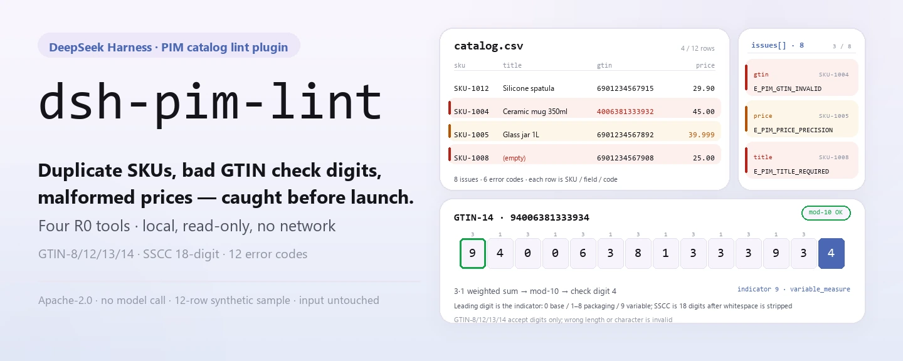
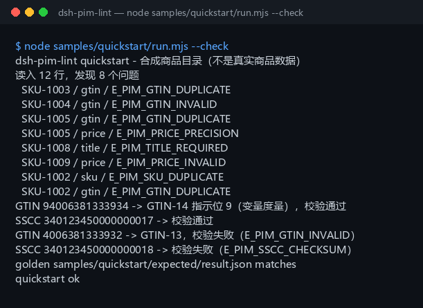

<div align="center">

<picture>
  <source media="(prefers-color-scheme: dark)" srcset="docs/assets/dsh-pim-lint-hero-en-dark.webp">
  
</picture>

# dsh-pim-lint

**Detecta SKU duplicados, dígitos de control GTIN erróneos y precios mal formados antes de publicar el catálogo.**

Un lint de catálogo PIM puramente local para DeepSeek Harness: lee un CSV UTF-8, comprueba los códigos de barras con las reglas GS1 y devuelve cada problema como SKU / campo / código de error; sin red, sin llamada a modelo y sin tocar tus archivos.

[Instalación](#instalación-en-tres-pasos) · [Configuración](#configuración) · [FAQ](#faq) · [简体中文](README.md) · [English](README.en.md) · [Español](README.es.md) · [Português](README.pt.md) · [हिन्दी](README.hi.md)

[](LICENSE)
[](#compatibilidad)
[](https://www.npmjs.com/package/dsh-pim-lint)
[](https://github.com/PerryLink/dsh-pim-lint/actions/workflows/ci.yml)
[](#compatibilidad)

[](https://github.com/PerryLink/dsh-pim-lint/stargazers)
[](https://www.npmjs.com/package/dsh-pim-lint)
[](https://dshfind.com/plugins/PerryLink/dsh-pim-lint?ref=badge)
[](https://dsh.market/)
[](https://gitee.com/perrylink/dsh-plugins)

```sh
dsh plugin --profile <profile> add dsh-pim-lint
```

</div>

<sub>Plugin de la comunidad, no afiliado a DeepSeek. Repositorio canónico: <https://github.com/PerryLink/dsh-pim-lint> (los repositorios homónimos de otras cuentas no están afiliados; Gitee es un espejo agregado). Estado: alpha · solo validación pública/sintética · no GA: sin datos ni evidencia de clientes, sin promesa de producción.</sub>

## Qué es

El primer tramo del dato maestro de producto: pasa un CSV de catálogo exportado de un PIM / ERP / Excel por comprobaciones fila a fila — columnas obligatorias, SKU duplicados, GTIN duplicados, dígito de control del GTIN, precisión del precio y precios negativos — y devuelve una lista de problemas con la forma SKU / campo / código de error. `pim.validate` lee la tabla entera; `pim.gtin_check`, `pim.gtin_structure` y `pim.sscc_check` comprueban códigos sueltos y unidades logísticas: el GTIN tiene 8/12/13/14 dígitos, el primer dígito de un GTIN-14 se descifra según las reglas GS1 como indicador de empaque y marca de medida variable, y el SSCC tiene 18 dígitos con un dígito de control mod-10 al final. Las cuatro herramientas son de solo lectura (R0) y calculan en tu máquina; sin red, sin llamada a modelo, sin subidas, y el archivo original nunca se modifica. El proyecto se mantiene activo desde el 2026-11-01, con nuevas funciones, endurecimiento y evidencia continua.

- **Encaja**: tablas de datos maestros de decenas a miles de filas (CSV UTF-8); una autocomprobación de códigos duplicados, códigos de barras y formatos de precio antes de un lanzamiento o un cambio de precios.
- **No encaja**: descripciones de producto en texto libre sin SKU ni código de barras; una conexión directa con Tmall / JD / ERP (este paquete no habla con ningún sistema externo); sustituir un registro GS1 o una revisión de canal.

<picture>
  <source media="(prefers-color-scheme: dark)" srcset="docs/assets/dsh-pim-lint-flow-v5-dark.svg">
  
</picture>

## Instalación en tres pasos

1. **Instala** (elige un canal):

   ```sh
   # canal npm (recomendado, versiones publicadas)
   dsh plugin --profile <profile> add dsh-pim-lint
   # canal git (último main; equivale a git+https://github.com/PerryLink/dsh-pim-lint.git)
   dsh plugin --profile <profile> add github:PerryLink/dsh-pim-lint
   # canal tarball: pnpm pack en este repo y luego
   dsh plugin --profile <profile> add ./dsh-pim-lint-<version>.tgz
   ```

2. **Configuración mínima** (el comando de instalación ya aplica el patch del bundle; copia esta fila si escribes el perfil a mano):

   ```yaml
   - insert:
       - id: dsh-pim-lint
         name: dsh-pim-lint
   ```

   No hay claves de configuración de Schemastery; todo lo ajustable se pasa en cada llamada a la herramienta — ver «Configuración».

3. **Verifica que se monta**:

   ```sh
   dsh --profile <profile> --dump-config | grep dsh-pim-lint
   pnpm install --frozen-lockfile && pnpm build   # compila antes de ejecutar la muestra en el repo; el paquete npm ya trae lib/
   node samples/quickstart/run.mjs --check        # debe imprimir quickstart ok
   ```

   El repo incluye una muestra sintética (12 filas de catálogo + 2 de códigos); ejecútala una vez para ver toda la cadena. En una sesión también puedes decir:

   > Tengo un CSV de catálogo de productos: busca SKU duplicados, problemas de dígito de control GTIN y de precisión de precio, y lista los problemas por SKU.

**Desinstalar**: `dsh plugin --profile <profile> remove dsh-pim-lint` (o borra la fila del patch del perfil).

<details>
<summary>Instalar desde el mercado de DSH Desktop</summary>

Todos los plugins de PerryLink aparecen en el mercado integrado de DSH Desktop: **Mercado → Fuentes → Añadir fuente → pegar** `https://perrylink-dsh-catalog.perrylink.workers.dev/catalog-source.json` **→ seleccionar**. La instalación sigue requiriendo la comprobación de identidad npm del mercado y tu confirmación.

</details>

## Capacidades principales

- **Validación de toda la tabla** — `pim.validate` lee un CSV entero de una vez: SKU obligatorio y único (sin distinguir mayúsculas), título obligatorio, dígito de control del GTIN y detección de GTIN duplicados, y un precio que debe ser no negativo con dos decimales como máximo; devuelve el número de filas y un arreglo de problemas.
- **Dígito de control GTIN** — `pim.gtin_check` valida GTIN-8/12/13/14 con el algoritmo mod-10 ponderado 3/1 de GS1; los espacios, las letras o un número de dígitos distinto siempre salen inválidos.
- **Estructura del GTIN** — `pim.gtin_structure` informa el formato (GTIN-8/12/13/14), el resultado del control, el indicador de empaque de GTIN-14 (1–8 nivel de empaque, 9 medida variable, 0 unidad base) y la marca `variable_measure`.
- **Comprobación de SSCC** — `pim.sscc_check` valida un código de unidad logística de 18 dígitos: primero elimina los espacios y luego mantiene separados un error de formato (`E_PIM_SSCC_FORMAT`) y un dígito de control incorrecto (`E_PIM_SSCC_CHECKSUM`).
- **Guarda de estructura del CSV** — un archivo solo con cabecera (`E_PIM_CSV_EMPTY`), una columna obligatoria ausente (`E_PIM_HEADER`) y una fila cuyo número de celdas no coincide con la cabecera (`E_PIM_CSV_ROW`) lanzan error, de modo que el analizador nunca adivina dónde está una columna.
- **Solo lectura, cero escrituras** — las cuatro herramientas son R0: no escriben `$DSH_HOME`, no escriben archivos temporales y no tocan tu CSV; la lista de problemas solo existe en la terminal y en el valor de retorno.

### Superficie de herramientas

Los nombres de herramienta son la API estable (se mantienen en inglés para coincidir con la salida del runtime); las descripciones están localizadas. Las cuatro herramientas son de solo lectura y no hay herramienta de escritura R1.

| Herramienta | Propósito | Riesgo |
|---|---|---|
| `pim.validate` | Valida filas CSV `sku,title,gtin,price` y devuelve el número de filas y la lista de problemas | R0 |
| `pim.gtin_check` | Valida el dígito de control GTIN-8/12/13/14 | R0 |
| `pim.gtin_structure` | Descompone el formato del GTIN, el indicador de empaque y la marca de medida variable | R0 |
| `pim.sscc_check` | Valida un SSCC de 18 dígitos y su dígito de control mod-10 | R0 |

### Entrada y salida

Entrada:

- Formato: CSV UTF-8 (con o sin BOM); la cabecera debe llevar `sku,title,gtin,price` (sin distinguir mayúsculas, se admiten otras columnas); `gtin` puede estar vacío y `price` usa dos decimales.
- Tamaño: mantén una tabla ≤ 5 MB (unas 20 000 filas); no hay un límite duro interno — más allá, divide por marca o categoría.
- Origen: exporta desde un PIM / ERP / Excel y guarda como CSV; el archivo original nunca se modifica.
- Comprobaciones de un solo código: `pim.gtin_check` y `pim.gtin_structure` reciben una cadena GTIN, y `pim.sscc_check` recibe una cadena SSCC.

Salida:

- Lista de problemas en terminal: cada fila informa `SKU / campo / código de error` (por ejemplo `SKU-1004 / gtin / E_PIM_GTIN_INVALID`), más la estructura del GTIN y el resultado del SSCC.
- Nada en disco: las cuatro herramientas son de solo lectura (R0) y no escriben ni `$DSH_HOME` ni tu CSV.
- Archivo dorado: `samples/quickstart/expected/result.json`, producido por una ejecución real.

### Ejemplos

Copia este prompt tal cual (el prompt de demostración de `package.json`):

```text
我有一份商品目录 CSV，帮我查重复 SKU、GTIN 校验位和价格精度，把问题按 SKU 列出来。
```

O ejecútalo tú mismo (ejecución real; la captura viene de este comando):

```sh
node samples/quickstart/run.mjs --check
```



*12 filas de catálogo sintético → 8 problemas (3 GTIN duplicados, 1 dígito de control erróneo, 1 SKU duplicado, 1 título ausente, 1 precio negativo, 1 precisión de precio), más un GTIN-14 de medida variable y un SSCC erróneo; el archivo dorado es `samples/quickstart/expected/result.json`, comando y hashes en `screenshots.json`.*

Aceptación con fixture público/sintético: vuelve a ejecutar `node scripts/acceptance.mjs`; el detalle se escribe en `ACCEPTANCE.csv` (citado tal cual):

```csv
req_id,metric,threshold,actual,script,evidence_sha256,pass,source,counted
PIM-A01,valid catalog accepted,1/1,1,scripts/acceptance.mjs,8c73f1d813c01bb7b0aac5c1ad766c5556e838bc2427d498bf1d2824ccbe7058,true,public/synthetic,false
PIM-A02,duplicate/bad GTIN/price issues,3,4,scripts/acceptance.mjs,8c73f1d813c01bb7b0aac5c1ad766c5556e838bc2427d498bf1d2824ccbe7058,true,public/synthetic,false
PIM-A03,GTIN check digit,1/1,1,scripts/acceptance.mjs,8c73f1d813c01bb7b0aac5c1ad766c5556e838bc2427d498bf1d2824ccbe7058,true,public/synthetic,false
PIM-A04,GTIN-14 packaging indicator / variable measure,9,9,scripts/acceptance.mjs,8c73f1d813c01bb7b0aac5c1ad766c5556e838bc2427d498bf1d2824ccbe7058,true,public/synthetic,false
PIM-A05,duplicate GTIN reported,1,1,scripts/acceptance.mjs,8c73f1d813c01bb7b0aac5c1ad766c5556e838bc2427d498bf1d2824ccbe7058,true,public/synthetic,false
PIM-A06,over-precise price reported,1,1,scripts/acceptance.mjs,8c73f1d813c01bb7b0aac5c1ad766c5556e838bc2427d498bf1d2824ccbe7058,true,public/synthetic,false
PIM-A07,SSCC mod-10 check,1,1,scripts/acceptance.mjs,8c73f1d813c01bb7b0aac5c1ad766c5556e838bc2427d498bf1d2824ccbe7058,true,public/synthetic,false
PS1-QS01,quickstart 样例与金标一致,1/1,1,scripts/acceptance.mjs,8ec26f4f03fdfab708172b98887bbd9e836aa1bdc5df92a23453ee9e7e3b0285,true,synthetic/quickstart,true
```

*`pnpm gate` (`scripts/gate.mjs`) repite esta aceptación y luego comprueba en cada fila las 9 columnas, `pass=true`, `actual` y `evidence_sha256` no vacíos, y la presencia de PS1-QS01. Las filas PIM son comprobaciones con fixture público/sintético (`counted=false`); PS1-QS01 es la repetición de la muestra incluida (`counted=true`). Ninguna es una ejecución de cliente y no se inventa ninguna salida; los hashes por fila están en [`ACCEPTANCE.csv`](ACCEPTANCE.csv).*

## Configuración

Este plugin no tiene claves `Config` de Schemastery: `cordis.patch.yml` solo `insert`a una fila (ver «Instalación en tres pasos»). Todo lo ajustable es un parámetro por llamada:

| Parámetro | Valor por defecto | Significado |
|---|---|---|
| `csv_text` (`pim.validate`) | ninguno (obligatorio) | Todo el CSV del catálogo como texto; la cabecera debe llevar `sku,title,gtin,price`, se admiten otras columnas y el BOM es opcional |
| `gtin` (`pim.gtin_check` / `pim.gtin_structure`) | ninguno (obligatorio) | El código de barras a comprobar; solo se aceptan 8/12/13/14 dígitos |
| `sscc` (`pim.sscc_check`) | ninguno (obligatorio) | Un código de unidad logística de 18 dígitos; primero se eliminan los espacios y luego se juzgan por separado el formato y el dígito de control |

<details>
<summary>Tabla completa de códigos de error (12)</summary>

| Código | Disparador | Dónde aparece |
|---|---|---|
| `E_PIM_CSV_EMPTY` | Solo cabecera, sin filas de producto | Se lanza |
| `E_PIM_HEADER` | Falta una de `sku` / `title` / `gtin` / `price` en la cabecera | Se lanza (la columna que falta va en `detail`) |
| `E_PIM_CSV_ROW` | El número de celdas de una fila no coincide con la cabecera | Se lanza (el número de fila y de celdas van en `detail`) |
| `E_PIM_SKU_REQUIRED` | El SKU está vacío | Lista de problemas |
| `E_PIM_SKU_DUPLICATE` | SKU duplicado (sin distinguir mayúsculas) | Lista de problemas |
| `E_PIM_TITLE_REQUIRED` | El título está vacío | Lista de problemas |
| `E_PIM_GTIN_INVALID` | Dígitos, caracteres o dígito de control del GTIN inválidos | Lista de problemas |
| `E_PIM_GTIN_DUPLICATE` | El mismo GTIN aparece más de una vez | Lista de problemas |
| `E_PIM_PRICE_INVALID` | Precio vacío, no numérico o negativo | Lista de problemas |
| `E_PIM_PRICE_PRECISION` | El precio tiene más de dos decimales | Lista de problemas |
| `E_PIM_SSCC_FORMAT` | El SSCC no tiene 18 dígitos | Campo `reason` |
| `E_PIM_SSCC_CHECKSUM` | El dígito de control mod-10 del SSCC es incorrecto | Campo `reason` |

Los tres errores de nivel CSV se lanzan con la misma forma: una frase llana, el código de error y una acción siguiente; síntomas / causas / acciones en [TROUBLESHOOTING.md](TROUBLESHOOTING.md).

</details>

## FAQ

<details>
<summary>No se instala, ¿y ahora qué?</summary>

Comprueba que DSH sea `>=0.2.1-rc.3 <0.4.0` y Node `>=24.9 <25` (ver «Compatibilidad») y reintenta `dsh plugin --profile <profile> add dsh-pim-lint`; si sigue fallando, lee el punto 1 de [TROUBLESHOOTING.md](TROUBLESHOOTING.md) y abre un issue con la versión del paquete, una entrada sintética mínima y el error completo.

</details>

<details>
<summary>Un código de barras da E_PIM_GTIN_INVALID, ¿están mal los datos o la herramienta?</summary>

Ejecuta primero `node samples/quickstart/run.mjs --check`: si pasa, la cadena está bien y el problema está en los datos. Luego revisa si la cabecera es exactamente `sku,title,gtin,price` y si el archivo es UTF-8. Un GTIN solo tiene 8/12/13/14 dígitos; los espacios o las letras cuentan como inválidos. Usa `pim.gtin_structure` para revisar el número de dígitos, el formato y el primer dígito del GTIN-14: eso separa «longitud incorrecta» de «dígito de control incorrecto».

</details>

<details>
<summary>¿Dónde se guardan los datos? ¿Se modifica mi catálogo?</summary>

No se modifica ningún archivo. Las cuatro herramientas son de solo lectura y no escriben ni `$DSH_HOME` ni archivos temporales; la lista de problemas vive solo en la terminal y en el valor de retorno. La sesión lee el CSV y lo pasa a las herramientas como parámetro, sin subidas ni red.

</details>

<details>
<summary>¿Puedo usar datos reales de producto?</summary>

Se ejecuta en local, pero este paquete es alpha y solo está validado con datos públicos/sintéticos, así que no constituye una conclusión de cumplimiento ni de revisión de canal; anonimiza los datos reales y no pegues una tabla de productos real en un issue.

</details>

<details>
<summary>¿Llama a la red o a un modelo?</summary>

No. Herramientas, muestras y aceptación se ejecutan en local; el código fuente no contiene llamadas HTTP / DNS / WebSocket y no interviene ningún modelo: cada veredicto es una regla determinista.

</details>

## Límites de seguridad

- **Solo lectura (R0).** Ninguna de las cuatro herramientas escribe un archivo: ni `$DSH_HOME`, ni archivos temporales, ni cambios en el CSV de entrada; `pim.validate` informa su lista de problemas solo en el valor de retorno.
- **Sin red y sin llamada a modelo.** Salvo que una herramienta lo diga explícitamente, no hay llamada a modelo ni a red; la entrada y la salida se quedan en local.
- **Los archivos originales no se modifican.** La sesión lee el CSV y lo pasa como parámetro de texto; las herramientas analizan solo esa copia.
- **No acapara espacios de nombres.** Solo registra cuatro herramientas `pim.*`: sin claves de servicio, sin comandos ni slots de cliente, sin rutas `webServer` y sin sobrescribir objetos globales.
- **Fallos ruidosos, sin adivinar.** Un archivo solo con cabecera, una columna obligatoria ausente o una fila con celdas de más lanzan error en vez de omitir en silencio o adivinar posiciones; la forma uniforme es «una frase llana (`E_XXX`) | siguiente paso: <acción>».
- **Sin aval de cumplimiento.** Un dígito de control válido y una estructura correcta no hacen vendible un producto: este paquete no consulta el registro GS1, no se conecta a revisiones de canal y no juzga la titularidad del producto ni su clase fiscal.

## Permisos y datos

- **Lectura**: el texto del CSV de catálogo que indiques en la sesión; ningún otro directorio.
- **Escritura**: ninguna. Las cuatro herramientas son de solo lectura: nada toca el disco y el archivo original queda intacto.
- **Red**: no (sin llamadas HTTP / DNS / WebSocket en el código).
- **Sistemas externos**: ninguno (no se contacta con PIM / ERP / marketplaces / servicios GS1).
- **Límite de datos**: solo muestras públicas/sintéticas; sin datos ni evidencia de clientes.

## Limitaciones conocidas

- **Solo validación pública/sintética.** Todas las filas de aceptación vienen de un fixture público o sintético (`counted=false` en las filas PIM, `counted=true` en la repetición PS1-QS01); sin datos ni evidencia de clientes.
- **alpha / parcial / no contabilizado / no GA.** Sin promesa de producción.
- **Solo CSV.** No se admiten xlsx, JSON, XML ni conexiones directas a ERP; exporta primero desde PIM / ERP / Excel a un CSV UTF-8.
- **El GTIN solo se comprueba de forma.** Valida el número de dígitos, los caracteres y el dígito de control mod-10; no consulta el registro GS1 ni juzga si el código pertenece realmente a ese producto.
- **Reglas de precio simples.** Solo se acepta un número no negativo con dos decimales como máximo; no se validan moneda, tasa de impuesto, precios promocionales ni rangos de precio.
- **El SSCC solo comprueba 18 dígitos y el dígito de control.** No valida el prefijo de empresa GS1 ni a qué nivel de empaque está ligado el código.
- **El tamaño de entrada es una convención.** Mantén una tabla ≤ 5 MB (unas 20 000 filas); no hay un límite duro interno — divide las tablas mayores por marca o categoría.
- **El CSV debe estar bien formado.** Un título con coma debe ir entre comillas dobles, o el número de celdas de la fila deja de coincidir y salta `E_PIM_CSV_ROW`.
- **Los límites exactos de cada herramienta** están en la tabla de «Capacidades principales» y en `ACCEPTANCE.csv`.

## Compatibilidad

| Dimensión | Estado |
|---|---|
| Harness | DeepSeek Harness `>=0.2.1-rc.3 <0.4.0` (`engines.dsh` en `package.json`) |
| Node | `>=24.9.0 <25` (coincide con el Node 24 que usa CI) |
| Plataforma | Donde corra DSH; solo archivos locales |
| Datos | Sin red, sin llamada a modelo, sin subidas |
| Modelo | No hace falta: cada veredicto es una regla determinista |

## Ecosistema y calidad

- [Espejo agregado en Gitee](https://gitee.com/perrylink/dsh-plugins) (varios plugins archivados en un solo repo; GitHub es el canónico)
- [Página de dshfind](https://dshfind.com/plugins/PerryLink/dsh-pim-lint) (instalaciones y ranking)
- [DSH Market](https://dsh.market/) (publicado)
- **Canal de la tienda 1024**: ejecuta `npm i -g dsh1024` y luego `dsh1024 plugin --profile <profile> add dsh-pim-lint` (cuenta para el ranking de instalaciones de [deepseek1024.com](https://deepseek1024.com))
- Documentación: [`TROUBLESHOOTING.md`](TROUBLESHOOTING.md) (resolución de problemas) · [`PRIVACY.md`](PRIVACY.md) · [`SECURITY.md`](SECURITY.md) · [`CHANGELOG.md`](CHANGELOG.md) · [índice de dominio](https://perrylink.github.io/dsh-plugins/) · [familia Checker](https://perrylink.github.io/zh/checkers/) · [familia principal](https://github.com/PerryLink/dsh-kit)

### Proyectos y verificadores relacionados

Paquetes hermanos e índices de familia: [dsh-hs-candidate](https://github.com/PerryLink/dsh-hs-candidate) · [dsh-freight-audit](https://github.com/PerryLink/dsh-freight-audit) · [dsh-policy-ledger](https://github.com/PerryLink/dsh-policy-ledger)

Cada verificador es un paquete aparte con su propio paquete de reglas y versión; instala solo los que necesites:

| Paquete | Por qué es relevante |
|---|---|
| [`dsh-excel-reconcile`](https://github.com/PerryLink/dsh-excel-reconcile) | Conciliación de dos tablas para exportaciones de catálogo/ERP, continuación natural de este lint fila a fila |
| [`dsh-data-quality`](https://github.com/PerryLink/dsh-data-quality) | Perfilado y limpieza deterministas, para lavar la tabla antes de pasarla por el lint |

## Desarrollo

```sh
pnpm install --frozen-lockfile                              # node >=24.9 <25
pnpm build && pnpm lint && pnpm typecheck && pnpm test      # build tsc + lint + typecheck + 10 casos node --test
pnpm gate                                                   # node scripts/gate.mjs: repite la aceptación y verifica ACCEPTANCE.csv
node scripts/acceptance.mjs                                 # repetir la aceptación pública/sintética, escribe evidence/ y ACCEPTANCE.csv
node samples/quickstart/run.mjs --check                     # muestra contra el archivo dorado; debe imprimir quickstart ok
```

Versión actual `0.1.1` (coincide con `package.json`). Pruebas: `node --test test/*.test.mjs` en verde con 10 casos en 4 archivos (`pim.test.mjs` 5, `sscc.test.mjs` 3, `plugin-smoke.test.mjs` 1, `quickstart.test.mjs` 1; `pnpm test` ya incluye el build). Estructura: el código TypeScript está en `src/` (`src/core/pim.ts` contiene el análisis de CSV y las comprobaciones GTIN y SSCC; `src/plugin/` es la cara host y el registro de herramientas), la salida de compilación en `lib/` (en gitignore; solo el paquete npm la lleva), la muestra sintética en `samples/quickstart/`, los registros de aceptación en `evidence/` y las imágenes en `docs/assets/`. El hero y el diagrama de estructura los genera [`scripts/gen-readme-assets.py`](scripts/gen-readme-assets.py) (Pillow genera los heroes de 1440×576 zh/en en claro/oscuro; un SVG escrito a mano genera el diagrama de estructura de 1100×660; compartido por los cinco idiomas) y se puede repetir con `python scripts/gen-readme-assets.py`.

Temas: `deepseek-harness`, `dsh`, `dsh-plugin`, `pim`, `gtin`, `perrylink`, `catalog`, `lint`

## Familia y agradecimientos

Este proyecto es miembro de la familia de plugins de DeepSeek Harness mantenida por [PerryLink](https://github.com/PerryLink) (todos Apache-2.0). Si este plugin te ayuda, **dale una estrella**: no desbloquea nada, pero hace que la siguiente persona lo encuentre más fácil.

- [@PerryLink](https://github.com/PerryLink) — creador y mantenedor: las comprobaciones del catálogo CSV, el dígito de control y la estructura del GTIN, la validación mod-10 del SSCC, la muestra quickstart y la suite de aceptación, y la documentación en cinco idiomas.

## Licencia

[LICENSE](LICENSE) (Apache License 2.0) © 2026 dsh-pim-lint contributors; ver también `NOTICE`.

<p align="center"><sub>Apache-2.0 · Plugin de la comunidad, no afiliado a DeepSeek.</sub></p>
