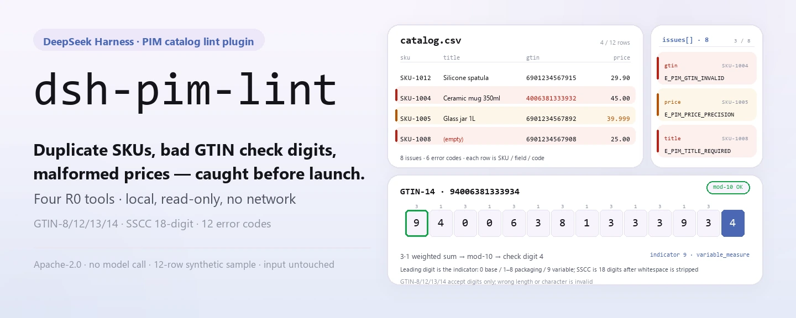
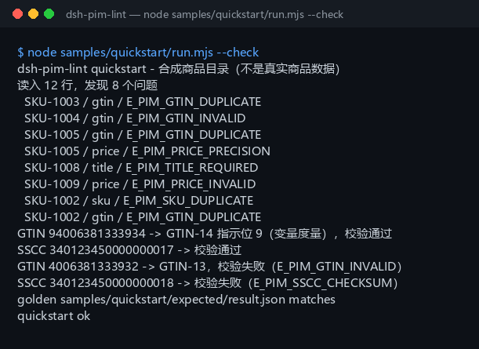

<div align="center">

<picture>
  <source media="(prefers-color-scheme: dark)" srcset="docs/assets/dsh-pim-lint-hero-en-dark.webp">
  
</picture>

# dsh-pim-lint

**कैटलॉग लाइव होने से पहले डुप्लिकेट SKU, गलत GTIN चेक डिजिट और खराब कीमतें एक साथ पकड़ें।**

DeepSeek Harness के लिए पूरी तरह लोकल PIM कैटलॉग lint: UTF-8 CSV पढ़ता है, GS1 नियमों से बारकोड जाँचता है और हर समस्या को SKU / फ़ील्ड / एरर कोड के रूप में देता है; न नेटवर्क, न मॉडल कॉल, न आपकी फ़ाइलों में बदलाव।

[इंस्टॉल](#तीन-चरणों-में-शुरुआत) · [कॉन्फ़िगरेशन](#कॉन्फ़िगरेशन) · [FAQ](#faq) · [简体中文](README.md) · [English](README.en.md) · [Español](README.es.md) · [Português](README.pt.md) · [हिन्दी](README.hi.md)

[](LICENSE)
[](#संगतता)
[](https://www.npmjs.com/package/dsh-pim-lint)
[](https://github.com/PerryLink/dsh-pim-lint/actions/workflows/ci.yml)
[](#संगतता)

[](https://github.com/PerryLink/dsh-pim-lint/stargazers)
[](https://www.npmjs.com/package/dsh-pim-lint)
[](https://dshfind.com/plugins/PerryLink/dsh-pim-lint?ref=badge)
[](https://dsh.market/)
[](https://gitee.com/perrylink/dsh-plugins)

```sh
dsh plugin --profile <profile> add dsh-pim-lint
```

</div>

<sub>कम्युनिटी प्लगइन, DeepSeek से संबद्ध नहीं। एकमात्र आधिकारिक रेपो: <https://github.com/PerryLink/dsh-pim-lint> (दूसरे खातों के इसी नाम के रेपो संबद्ध नहीं हैं; Gitee एक समग्र मिरर है)। स्थिति: alpha · केवल सार्वजनिक/सिंथेटिक डेटा पर सत्यापित · GA नहीं — ग्राहक डेटा या ग्राहक साक्ष्य नहीं, उत्पादन-उपयोग का दावा नहीं।</sub>

## यह क्या है

प्रोडक्ट मास्टर डेटा का पहला चरण: PIM / ERP / Excel से निर्यात की गई कैटलॉग CSV को पंक्ति-दर-पंक्ति जाँचता है — अनिवार्य कॉलम, डुप्लिकेट SKU, डुप्लिकेट GTIN, GTIN चेक डिजिट, कीमत की प्रिसीज़न और ऋणात्मक कीमतें — और SKU / फ़ील्ड / एरर कोड के रूप में समस्याओं की सूची देता है। `pim_validate` पूरी तालिका पढ़ता है; `pim_gtin_check`, `pim_gtin_structure` और `pim_sscc_check` अलग-अलग बारकोड और लॉजिस्टिक्स यूनिट जाँचते हैं: GTIN में 8/12/13/14 अंक होते हैं, GTIN-14 के पहले अंक को GS1 नियमों से पैकेजिंग इंडिकेटर और वेरिएबल-मेज़र फ़्लैग में खोला जाता है, और SSCC में 18 अंक होते हैं जिनमें आख़िरी अंक mod-10 चेक डिजिट है। चारों टूल रीड-ओनली (R0) हैं और आपकी मशीन पर ही गणना करते हैं; न नेटवर्क, न मॉडल कॉल, न अपलोड, और मूल फ़ाइल कभी नहीं बदलती। प्रोजेक्ट 2026-11-01 से सक्रिय रूप से मेंटेन हो रहा है, नए फ़ीचर, हार्डनिंग और ताज़ा साक्ष्य लगातार आ रहे हैं।

- **उपयुक्त**: दसियों से हज़ारों पंक्तियों की प्रोडक्ट मास्टर तालिकाएँ (UTF-8 CSV); लॉन्च या मूल्य-परिवर्तन से पहले डुप्लिकेट कोड, बारकोड और कीमत के फ़ॉर्मैट की स्वयं-जाँच।
- **उपयुक्त नहीं**: बिना SKU या बारकोड वाले मुक्त-पाठ प्रोडक्ट विवरण; Tmall / JD / ERP से सीधा कनेक्शन (यह पैकेज किसी बाहरी सिस्टम से बात नहीं करता); GS1 पंजीकरण या चैनल समीक्षा का विकल्प बनना।

<picture>
  <source media="(prefers-color-scheme: dark)" srcset="docs/assets/dsh-pim-lint-flow-v5-dark.svg">
  
</picture>

## तीन चरणों में शुरुआत

1. **इंस्टॉल करें** (कोई एक चैनल चुनें):

   ```sh
   # npm चैनल (अनुशंसित, प्रकाशित संस्करण)
   dsh plugin --profile <profile> add dsh-pim-lint
   # git चैनल (नवीनतम main; git+https://github.com/PerryLink/dsh-pim-lint.git के बराबर)
   dsh plugin --profile <profile> add github:PerryLink/dsh-pim-lint
   # tarball चैनल: इस रेपो में pnpm pack के बाद
   dsh plugin --profile <profile> add ./dsh-pim-lint-<version>.tgz
   ```

2. **न्यूनतम कॉन्फ़िग** (इंस्टॉल कमांड बंडल पैच पहले ही लगा देता है; प्रोफ़ाइल हाथ से लिखते समय यह पंक्ति कॉपी करें):

   ```yaml
   - insert:
       - id: dsh-pim-lint
         name: dsh-pim-lint
   ```

   इसमें Schemastery कॉन्फ़िग कुंजियाँ नहीं हैं; जो भी समायोज्य है वह हर टूल कॉल में पैरामीटर के रूप में जाता है — देखें «कॉन्फ़िगरेशन»।

3. **जाँचें कि माउंट हुआ**:

   ```sh
   dsh --profile <profile> --dump-config | grep dsh-pim-lint
   pnpm install --frozen-lockfile && pnpm build   # रेपो में सैंपल चलाने से पहले बिल्ड करें; npm पैकेज lib/ के साथ आता है
   node samples/quickstart/run.mjs --check        # quickstart ok प्रिंट होना चाहिए
   ```

   रेपो में सिंथेटिक सैंपल है (12 कैटलॉग पंक्तियाँ + 2 कोड पंक्तियाँ); एक बार चलाकर पूरी चेन देखें। सेशन में सीधे यह भी कह सकते हैं:

   > मेरे पास प्रोडक्ट कैटलॉग की CSV है — डुप्लिकेट SKU, GTIN चेक डिजिट और कीमत की प्रिसीज़न की समस्याएँ ढूँढ़ो और समस्याएँ SKU के हिसाब से लिस्ट करो।

**अनइंस्टॉल**: `dsh plugin --profile <profile> remove dsh-pim-lint` (या प्रोफ़ाइल पैच से वह पंक्ति हटा दें)।

<details>
<summary>DSH Desktop मार्केट से इंस्टॉल करें</summary>

सभी PerryLink प्लगइन DSH Desktop के अंतर्निहित मार्केट में मिलते हैं: **मार्केट → स्रोत → स्रोत जोड़ें → पेस्ट करें** `https://perrylink-dsh-catalog.perrylink.workers.dev/catalog-source.json` **→ चुनें**। इंस्टॉल के लिए मार्केट की npm पहचान जाँच और आपकी पुष्टि फिर भी ज़रूरी है।

</details>

## मुख्य क्षमताएँ

- **पूरी तालिका की जाँच** — `pim_validate` एक बार में पूरी CSV पढ़ता है: SKU अनिवार्य और अद्वितीय (केस-असंवेदी), title अनिवार्य, GTIN चेक डिजिट और डुप्लिकेट GTIN, और ऐसी कीमत जो ऋणात्मक न हो और अधिकतम दो दशमलव तक हो; पंक्ति-संख्या और समस्याओं का एरे लौटाता है।
- **GTIN चेक डिजिट** — `pim_gtin_check` GS1 के 3/1 भारित mod-10 एल्गोरिदम से GTIN-8/12/13/14 जाँचता है; स्पेस, अक्षर या गलत अंक-संख्या सभी अमान्य लौटते हैं।
- **GTIN संरचना** — `pim_gtin_structure` फ़ॉर्मैट (GTIN-8/12/13/14), चेक परिणाम, GTIN-14 का पैकेजिंग इंडिकेटर (1–8 पैकेजिंग स्तर, 9 वेरिएबल मेज़र, 0 बेस यूनिट) और `variable_measure` फ़्लैग बताता है।
- **SSCC जाँच** — `pim_sscc_check` 18 अंकों का लॉजिस्टिक्स यूनिट कोड जाँचता है: पहले स्पेस हटाता है, फिर फ़ॉर्मैट त्रुटि (`E_PIM_SSCC_FORMAT`) और गलत चेक डिजिट (`E_PIM_SSCC_CHECKSUM`) को अलग-अलग रखता है।
- **CSV संरचना गार्ड** — केवल हेडर वाली फ़ाइल (`E_PIM_CSV_EMPTY`), अनिवार्य कॉलम की कमी (`E_PIM_HEADER`) और हेडर से अलग सेल-संख्या वाली पंक्ति (`E_PIM_CSV_ROW`) तुरंत एरर देती हैं, इसलिए पार्सर कभी कॉलम की जगह का अनुमान नहीं लगाता।
- **रीड-ओनली, शून्य लेखन** — चारों टूल R0 हैं: न `$DSH_HOME` लिखते हैं, न अस्थायी फ़ाइल, न आपकी CSV बदलते हैं; समस्याओं की सूची केवल टर्मिनल और रिटर्न वैल्यू में रहती है।

### टूल सरफ़ेस

टूल नाम स्थिर API हैं (रनटाइम आउटपुट से मेल खाने के लिए अंग्रेज़ी में); विवरण स्थानीयकृत हैं। चारों टूल रीड-ओनली हैं और कोई R1 राइट टूल नहीं है। सभी नाम `^[a-zA-Z0-9_-]+$` से मेल खाते हैं (अंडरस्कोर, बिना बिंदु); provider बिंदु वाले `tools[].name` को अस्वीकार करता है।

| टूल | उद्देश्य | जोखिम |
|---|---|---|
| `pim_validate` | `sku,title,gtin,price` CSV पंक्तियाँ जाँचकर पंक्ति-संख्या और समस्याओं की सूची देता है | R0 |
| `pim_gtin_check` | GTIN-8/12/13/14 का चेक डिजिट जाँचता है | R0 |
| `pim_gtin_structure` | GTIN फ़ॉर्मैट, पैकेजिंग इंडिकेटर और वेरिएबल-मेज़र फ़्लैग में तोड़ता है | R0 |
| `pim_sscc_check` | 18 अंकों का SSCC और उसका mod-10 चेक डिजिट जाँचता है | R0 |

### इनपुट और आउटपुट

इनपुट:

- फ़ॉर्मैट: UTF-8 CSV (BOM के साथ या बिना); हेडर में `sku,title,gtin,price` होना चाहिए (केस-असंवेदी, अन्य कॉलम मान्य); `gtin` खाली हो सकता है और `price` दो दशमलव में।
- आकार: एक तालिका ≤ 5 MB (लगभग 20 हज़ार पंक्तियाँ) रखें; कोई अंतर्निहित कठोर सीमा नहीं है — उससे बड़ी तालिका ब्रांड या श्रेणी से बाँटें।
- स्रोत: PIM / ERP / Excel से निर्यात करके CSV में सहेजें; मूल फ़ाइल कभी नहीं बदलती।
- एकल-कोड जाँच: `pim_gtin_check` और `pim_gtin_structure` एक-एक GTIN स्ट्रिंग लेते हैं, और `pim_sscc_check` एक SSCC स्ट्रिंग।

आउटपुट:

- टर्मिनल पर समस्याओं की सूची: हर पंक्ति `SKU / फ़ील्ड / एरर कोड` देती है (जैसे `SKU-1004 / gtin / E_PIM_GTIN_INVALID`), साथ में GTIN संरचना और SSCC परिणाम।
- डिस्क पर कुछ नहीं: चारों टूल रीड-ओनली (R0) हैं, न `$DSH_HOME` लिखते हैं न आपकी CSV।
- गोल्डन फ़ाइल: `samples/quickstart/expected/result.json`, किसी वास्तविक रन से बनी।

### उदाहरण

यह प्रॉम्प्ट जैसा है वैसा कॉपी करें (`package.json` का डेमो प्रॉम्प्ट):

```text
我有一份商品目录 CSV，帮我查重复 SKU、GTIN 校验位和价格精度，把问题按 SKU 列出来。
```

या खुद चलाएँ (वास्तविक रन; स्क्रीनशॉट इसी कमांड से है):

```sh
node samples/quickstart/run.mjs --check
```



*12 सिंथेटिक कैटलॉग पंक्तियाँ → 8 समस्याएँ (3 डुप्लिकेट GTIN, 1 गलत चेक डिजिट, 1 डुप्लिकेट SKU, 1 खाली title, 1 ऋणात्मक कीमत, 1 कीमत प्रिसीज़न), साथ में एक GTIN-14 वेरिएबल-मेज़र कोड और एक गलत SSCC; गोल्डन फ़ाइल `samples/quickstart/expected/result.json` है, कमांड और हैश `screenshots.json` में।*

सार्वजनिक/सिंथेटिक fixture स्वीकृति: `node scripts/acceptance.mjs` फिर चलाएँ; विवरण `ACCEPTANCE.csv` में लिखा जाता है (शब्दशः उद्धृत):

```csv
req_id,metric,threshold,actual,script,evidence_sha256,pass,source,counted
PIM-A01,valid catalog accepted,1/1,1,scripts/acceptance.mjs,8c73f1d813c01bb7b0aac5c1ad766c5556e838bc2427d498bf1d2824ccbe7058,true,public/synthetic,false
PIM-A02,duplicate/bad GTIN/price issues,3,4,scripts/acceptance.mjs,8c73f1d813c01bb7b0aac5c1ad766c5556e838bc2427d498bf1d2824ccbe7058,true,public/synthetic,false
PIM-A03,GTIN check digit,1/1,1,scripts/acceptance.mjs,8c73f1d813c01bb7b0aac5c1ad766c5556e838bc2427d498bf1d2824ccbe7058,true,public/synthetic,false
PIM-A04,GTIN-14 packaging indicator / variable measure,9,9,scripts/acceptance.mjs,8c73f1d813c01bb7b0aac5c1ad766c5556e838bc2427d498bf1d2824ccbe7058,true,public/synthetic,false
PIM-A05,duplicate GTIN reported,1,1,scripts/acceptance.mjs,8c73f1d813c01bb7b0aac5c1ad766c5556e838bc2427d498bf1d2824ccbe7058,true,public/synthetic,false
PIM-A06,over-precise price reported,1,1,scripts/acceptance.mjs,8c73f1d813c01bb7b0aac5c1ad766c5556e838bc2427d498bf1d2824ccbe7058,true,public/synthetic,false
PIM-A07,SSCC mod-10 check,1,1,scripts/acceptance.mjs,8c73f1d813c01bb7b0aac5c1ad766c5556e838bc2427d498bf1d2824ccbe7058,true,public/synthetic,false
PS1-QS01,quickstart 样例与金标一致,1/1,1,scripts/acceptance.mjs,8ec26f4f03fdfab708172b98887bbd9e836aa1bdc5df92a23453ee9e7e3b0285,true,synthetic/quickstart,true
```

*`pnpm gate` (`scripts/gate.mjs`) पहले यह स्वीकृति दोबारा चलाता है, फिर हर पंक्ति में 9 कॉलम, `pass=true`, रिक्त-रहित `actual` और `evidence_sha256`, और PS1-QS01 की मौजूदगी जाँचता है। PIM पंक्तियाँ सार्वजनिक/सिंथेटिक fixture जाँच हैं (`counted=false`); PS1-QS01 बंडल किए गए सैंपल का लोकल पुनरावर्तन है (`counted=true`)। कोई भी ग्राहक रन नहीं है और कोई आउटपुट गढ़ा नहीं गया; प्रति-पंक्ति हैश [`ACCEPTANCE.csv`](ACCEPTANCE.csv) में हैं।*

## कॉन्फ़िगरेशन

इस प्लगइन में Schemastery `Config` कुंजियाँ नहीं हैं — `cordis.patch.yml` केवल एक पंक्ति `insert` करता है (देखें «तीन चरणों में शुरुआत»)। जो भी समायोज्य है वह प्रति-कॉल टूल पैरामीटर है:

| पैरामीटर | डिफ़ॉल्ट | अर्थ |
|---|---|---|
| `csv_text` (`pim_validate`) | कोई नहीं (अनिवार्य) | पूरी कैटलॉग CSV टेक्स्ट के रूप में; हेडर में `sku,title,gtin,price` होना चाहिए, अन्य कॉलम मान्य, BOM वैकल्पिक |
| `gtin` (`pim_gtin_check` / `pim_gtin_structure`) | कोई नहीं (अनिवार्य) | जाँचने वाला बारकोड; केवल 8/12/13/14 अंक स्वीकार्य |
| `sscc` (`pim_sscc_check`) | कोई नहीं (अनिवार्य) | 18 अंकों का लॉजिस्टिक्स यूनिट कोड; पहले स्पेस हटते हैं, फिर फ़ॉर्मैट और चेक डिजिट अलग-अलग तय होते हैं |

<details>
<summary>पूरी एरर-कोड तालिका (12 कोड)</summary>

| कोड | कब आता है | कहाँ दिखता है |
|---|---|---|
| `E_PIM_CSV_EMPTY` | केवल हेडर, कोई प्रोडक्ट पंक्ति नहीं | एरर फेंका जाता है |
| `E_PIM_HEADER` | हेडर में `sku` / `title` / `gtin` / `price` में से कोई कमी | एरर फेंका जाता है (कमी वाला कॉलम `detail` में) |
| `E_PIM_CSV_ROW` | किसी पंक्ति की सेल-संख्या हेडर से मेल नहीं खाती | एरर फेंका जाता है (पंक्ति-संख्या और सेल-संख्या `detail` में) |
| `E_PIM_SKU_REQUIRED` | SKU खाली है | समस्याओं की सूची |
| `E_PIM_SKU_DUPLICATE` | SKU डुप्लिकेट (केस-असंवेदी) | समस्याओं की सूची |
| `E_PIM_TITLE_REQUIRED` | title खाली है | समस्याओं की सूची |
| `E_PIM_GTIN_INVALID` | GTIN के अंक, अक्षर या चेक डिजिट अमान्य | समस्याओं की सूची |
| `E_PIM_GTIN_DUPLICATE` | वही GTIN एक से अधिक बार | समस्याओं की सूची |
| `E_PIM_PRICE_INVALID` | कीमत खाली, संख्या नहीं या ऋणात्मक | समस्याओं की सूची |
| `E_PIM_PRICE_PRECISION` | कीमत में दो से अधिक दशमलव | समस्याओं की सूची |
| `E_PIM_SSCC_FORMAT` | SSCC में 18 अंक नहीं | `reason` फ़ील्ड |
| `E_PIM_SSCC_CHECKSUM` | SSCC का mod-10 चेक डिजिट गलत | `reason` फ़ील्ड |

CSV-स्तर के तीन एरर एक ही रूप में फेंके जाते हैं: एक सीधी बात, एरर कोड और एक अगला कदम; लक्षण / कारण / क्रिया [TROUBLESHOOTING.md](TROUBLESHOOTING.md) में।

</details>

## FAQ

<details>
<summary>इंस्टॉल नहीं हो रहा, क्या करें?</summary>

जाँचें कि DSH `>=0.2.1-rc.3 <0.4.0` और Node `>=24.9 <25` है (देखें «संगतता»), फिर `dsh plugin --profile <profile> add dsh-pim-lint` दोबारा चलाएँ; फिर भी विफल हो तो [TROUBLESHOOTING.md](TROUBLESHOOTING.md) का पहला आइटम पढ़ें और पैकेज संस्करण, न्यूनतम सिंथेटिक इनपुट और पूरा एरर लेकर issue खोलें।

</details>

<details>
<summary>बारकोड E_PIM_GTIN_INVALID दे रहा है — डेटा गलत है या टूल?</summary>

पहले `node samples/quickstart/run.mjs --check` चलाएँ: पास हो जाए तो चेन ठीक है और समस्या डेटा में है। फिर देखें कि हेडर ठीक `sku,title,gtin,price` है और फ़ाइल UTF-8 है। GTIN में केवल 8/12/13/14 अंक होते हैं; स्पेस या अक्षर अमान्य माने जाते हैं। अंक-संख्या, फ़ॉर्मैट और GTIN-14 के पहले अंक को `pim_gtin_structure` से जाँचें — इससे «लंबाई गलत» और «चेक डिजिट गलत» अलग हो जाते हैं।

</details>

<details>
<summary>डेटा कहाँ रहता है? क्या मेरा कैटलॉग बदलेगा?</summary>

कोई फ़ाइल नहीं बदलती। चारों टूल रीड-ओनली हैं और न `$DSH_HOME` लिखते हैं न अस्थायी फ़ाइल; समस्याओं की सूची केवल टर्मिनल और रिटर्न वैल्यू में रहती है। सेशन CSV पढ़कर टूल को पैरामीटर के रूप में देता है, कोई अपलोड नहीं, कोई नेटवर्क नहीं।

</details>

<details>
<summary>क्या मैं असली प्रोडक्ट डेटा इस्तेमाल कर सकता हूँ?</summary>

यह लोकल चलता है, लेकिन पैकेज alpha है और केवल सार्वजनिक/सिंथेटिक डेटा पर सत्यापित है, इसलिए यह अनुपालन या चैनल-समीक्षा का निष्कर्ष नहीं है; असली डेटा को पहले अनाम करें और असली प्रोडक्ट तालिका issue में न चिपकाएँ।

</details>

<details>
<summary>क्या यह नेटवर्क या मॉडल कॉल करता है?</summary>

नहीं। टूल, सैंपल और स्वीकृति सब लोकल चलते हैं; सोर्स में कोई HTTP / DNS / WebSocket कॉल नहीं है और कोई मॉडल शामिल नहीं — हर निर्णय एक नियतात्मक नियम है।

</details>

## सुरक्षा सीमाएँ

- **रीड-ओनली (R0)।** चारों में से कोई टूल फ़ाइल नहीं लिखता: न `$DSH_HOME`, न अस्थायी फ़ाइल, न इनपुट CSV में बदलाव; `pim_validate` अपनी समस्या-सूची केवल रिटर्न वैल्यू में देता है।
- **कोई नेटवर्क नहीं, कोई मॉडल कॉल नहीं।** जब तक कोई टूल स्पष्ट रूप से न कहे, मॉडल या नेटवर्क कॉल नहीं होता; इनपुट और आउटपुट लोकल रहते हैं।
- **मूल फ़ाइलें कभी नहीं बदलतीं।** सेशन CSV पढ़कर टेक्स्ट पैरामीटर के रूप में देता है; टूल केवल उस कॉपी को पार्स करते हैं।
- **नेमस्पेस पर कब्ज़ा नहीं।** केवल चार `pim_*` टूल रजिस्टर करता है: कोई सर्विस कुंजी नहीं, कोई कमांड या क्लाइंट slot नहीं, कोई `webServer` रूट नहीं, और कोई ग्लोबल ऑब्जेक्ट ओवरराइड नहीं।
- **शोरगुल वाली विफलता, कोई अनुमान नहीं।** केवल-हेडर फ़ाइल, कमी वाला अनिवार्य कॉलम या अतिरिक्त सेल वाली पंक्ति चुपचाप छोड़ने या कॉलम की जगह का अनुमान लगाने के बजाय एरर देती है; एकरूप रूप है «एक सीधी बात (`E_XXX`) | अगला कदम: <क्रिया>»।
- **अनुपालन की गारंटी नहीं।** सही चेक डिजिट और सही संरचना किसी प्रोडक्ट को बिकाऊ नहीं बनातीं: यह पैकेज GS1 रजिस्ट्री नहीं खोजता, चैनल समीक्षा से नहीं जुड़ता और प्रोडक्ट का स्वामित्व या कर-वर्ग तय नहीं करता।

## अनुमतियाँ और डेटा

- **पढ़ना**: सेशन में आपके बताए कैटलॉग CSV का टेक्स्ट; कोई अन्य डायरेक्टरी नहीं।
- **लिखना**: कुछ नहीं। चारों टूल रीड-ओनली हैं: डिस्क पर कुछ नहीं जाता और मूल फ़ाइल अछूती रहती है।
- **नेटवर्क**: नहीं (सोर्स में कोई HTTP / DNS / WebSocket कॉल नहीं)।
- **बाहरी सिस्टम**: कोई नहीं (PIM / ERP / मार्केटप्लेस / GS1 सेवा से संपर्क नहीं)।
- **डेटा सीमा**: केवल सार्वजनिक/सिंथेटिक सैंपल; ग्राहक डेटा या ग्राहक साक्ष्य नहीं।

## ज्ञात सीमाएँ

- **केवल सार्वजनिक/सिंथेटिक सत्यापन।** स्वीकृति की हर पंक्ति सार्वजनिक या सिंथेटिक fixture से है (PIM पंक्तियों में `counted=false`, PS1-QS01 सैंपल पुनरावर्तन में `counted=true`); ग्राहक डेटा या ग्राहक साक्ष्य नहीं।
- **alpha / partial / not counted / GA नहीं।** उत्पादन-उपयोग का दावा नहीं।
- **केवल CSV।** xlsx, JSON, XML और सीधा ERP कनेक्शन समर्थित नहीं; पहले PIM / ERP / Excel से UTF-8 CSV में निर्यात करें।
- **GTIN केवल आकार जाँचता है।** अंक-संख्या, अक्षर और mod-10 चेक डिजिट देखता है; GS1 रजिस्ट्री नहीं खोजता और यह नहीं बताता कि कोड सचमुच उसी प्रोडक्ट का है।
- **कीमत के नियम सरल।** केवल अधिकतम दो दशमलव वाली गैर-ऋणात्मक संख्या स्वीकार्य; मुद्रा, कर-दर, प्रमोशनल कीमत और कीमत-सीमा जाँची नहीं जातीं।
- **SSCC केवल 18 अंक और चेक डिजिट जाँचता है।** GS1 कंपनी प्रीफ़िक्स या किसी पैकेजिंग स्तर से बंधाव की पुष्टि नहीं करता।
- **इनपुट आकार एक परंपरा है।** एक तालिका ≤ 5 MB (लगभग 20 हज़ार पंक्तियाँ) रखें; कोई अंतर्निहित कठोर सीमा नहीं — बड़ी तालिकाएँ ब्रांड या श्रेणी से बाँटें।
- **CSV सुव्यवस्थित होनी चाहिए।** कॉमा वाला title दोहरे उद्धरण में होना चाहिए, वरना पंक्ति की सेल-संख्या मेल नहीं खाती और `E_PIM_CSV_ROW` आ जाता है।
- **हर टूल की सटीक सीमाएँ** «मुख्य क्षमताएँ» की टूल तालिका और `ACCEPTANCE.csv` में हैं।

## संगतता

| आयाम | स्थिति |
|---|---|
| Harness | DeepSeek Harness `>=0.2.1-rc.3 <0.4.0` (`package.json` में `engines.dsh`) |
| Node | `>=24.9.0 <25` (CI में इस्तेमाल Node 24 के अनुरूप) |
| प्लेटफ़ॉर्म | जहाँ DSH चले; केवल लोकल फ़ाइलें |
| डेटा | कोई नेटवर्क नहीं, कोई मॉडल कॉल नहीं, कोई अपलोड नहीं |
| मॉडल | ज़रूरी नहीं: हर निर्णय एक नियतात्मक नियम है |

## इकोसिस्टम और गुणवत्ता

- [Gitee समग्र मिरर](https://gitee.com/perrylink/dsh-plugins) (कई प्लगइन एक ही रेपो में संग्रहीत; GitHub आधिकारिक है)
- [dshfind प्लगइन पेज](https://dshfind.com/plugins/PerryLink/dsh-pim-lint) (इंस्टॉल और रैंक)
- [DSH Market](https://dsh.market/) (सूचीबद्ध)
- **1024 स्टोर चैनल**: पहले `npm i -g dsh1024`, फिर `dsh1024 plugin --profile <profile> add dsh-pim-lint` ([deepseek1024.com](https://deepseek1024.com) की इंस्टॉल रैंकिंग में गिना जाता है)
- दस्तावेज़: [`TROUBLESHOOTING.md`](TROUBLESHOOTING.md) (समस्या-निवारण) · [`PRIVACY.md`](PRIVACY.md) · [`SECURITY.md`](SECURITY.md) · [`CHANGELOG.md`](CHANGELOG.md) · [डोमेन इंडेक्स](https://perrylink.github.io/dsh-plugins/) · [Checker परिवार](https://perrylink.github.io/zh/checkers/) · [मुख्य परिवार](https://github.com/PerryLink/dsh-kit)

### संबंधित प्रोजेक्ट और चेकर

सहोदर पैकेज और परिवार इंडेक्स: [dsh-hs-candidate](https://github.com/PerryLink/dsh-hs-candidate) · [dsh-freight-audit](https://github.com/PerryLink/dsh-freight-audit) · [dsh-policy-ledger](https://github.com/PerryLink/dsh-policy-ledger)

हर चेकर अलग पैकेज है, अपने नियम-पैक और संस्करण के साथ; केवल ज़रूरी वाले इंस्टॉल करें:

| पैकेज | क्यों प्रासंगिक है |
|---|---|
| [`dsh-excel-reconcile`](https://github.com/PerryLink/dsh-excel-reconcile) | कैटलॉग/ERP निर्यात के लिए दो-तालिका मिलान, इस पंक्ति-दर-पंक्ति lint का स्वाभाविक अगला कदम |
| [`dsh-data-quality`](https://github.com/PerryLink/dsh-data-quality) | नियतात्मक डेटा प्रोफ़ाइलिंग और सफ़ाई, ताकि lint से पहले तालिका धुल जाए |

## डेवलपमेंट

```sh
pnpm install --frozen-lockfile                              # node >=24.9 <25
pnpm build && pnpm lint && pnpm typecheck && pnpm test      # tsc बिल्ड + lint + typecheck + 11 node --test केस
pnpm gate                                                   # node scripts/gate.mjs: स्वीकृति दोबारा चलाकर ACCEPTANCE.csv जाँचता है
node scripts/acceptance.mjs                                 # सार्वजनिक/सिंथेटिक स्वीकृति दोबारा, evidence/ और ACCEPTANCE.csv लिखता है
node samples/quickstart/run.mjs --check                     # गोल्डन फ़ाइल से सैंपल मिलान; quickstart ok प्रिंट होना चाहिए
```

मौजूदा संस्करण `0.2.0` (`package.json` के अनुरूप)। टेस्ट: `node --test test/*.test.mjs` 5 फ़ाइलों में 11 केस के साथ हरा (`pim.test.mjs` 5, `sscc.test.mjs` 3, `plugin-smoke.test.mjs` 1, `quickstart.test.mjs` 1, `tool-name-wire.test.mjs` 1; `pnpm test` में बिल्ड पहले से शामिल है)। संरचना: TypeScript सोर्स `src/` में (`src/core/pim.ts` में CSV पार्सिंग और GTIN व SSCC जाँच; `src/plugin/` होस्ट फ़ेस और टूल रजिस्ट्रेशन), बिल्ड आउटपुट `lib/` में (gitignore; केवल npm पैकेज में जाता है), सिंथेटिक सैंपल `samples/quickstart/` में, स्वीकृति रिकॉर्ड `evidence/` में और चित्र `docs/assets/` में। शुरुआती hero और संरचना डायग्राम [`scripts/gen-readme-assets.py`](scripts/gen-readme-assets.py) से बनते हैं (Pillow 1440×576 के zh/en light/dark hero बनाता है; हाथ से लिखा SVG 1100×660 का संरचना डायग्राम बनाता है; पाँचों भाषाओं में साझा) और `python scripts/gen-readme-assets.py` से दोबारा चलाए जा सकते हैं।

विषय: `deepseek-harness`, `dsh`, `dsh-plugin`, `pim`, `gtin`, `perrylink`, `catalog`, `lint`

## परिवार और आभार

यह प्रोजेक्ट [PerryLink](https://github.com/PerryLink) द्वारा मेंटेन किए जाने वाले DeepSeek Harness प्लगइन परिवार का सदस्य है (सभी Apache-2.0)। अगर यह प्लगइन आपके काम आए, तो **एक स्टार दें** — इससे कोई फ़ीचर नहीं खुलता, पर अगला व्यक्ति इसे आसानी से ढूँढ़ पाता है।

- [@PerryLink](https://github.com/PerryLink) — निर्माता और मेंटेनर: CSV कैटलॉग जाँच, GTIN चेक डिजिट और संरचना पार्सिंग, SSCC mod-10 सत्यापन, quickstart सैंपल और स्वीकृति सूट, और पाँच-भाषा दस्तावेज़।

## लाइसेंस

[LICENSE](LICENSE) (Apache License 2.0) © 2026 dsh-pim-lint contributors; `NOTICE` भी देखें।

<p align="center"><sub>Apache-2.0 · कम्युनिटी प्लगइन, DeepSeek से संबद्ध नहीं।</sub></p>
