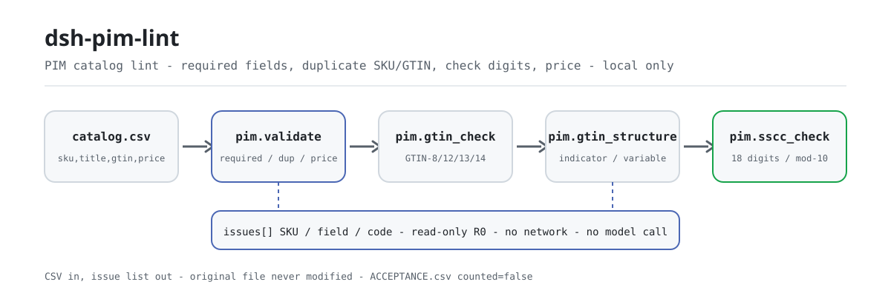
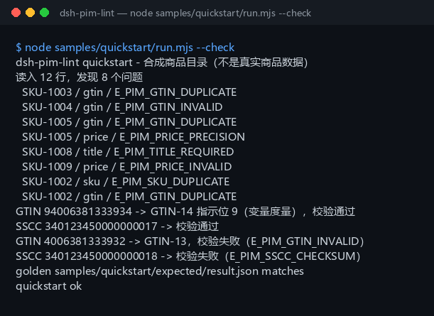

<div align="center">

<picture>
  <source media="(prefers-color-scheme: dark)" srcset="docs/assets/dsh-pim-lint-flow-dark.svg">
  
</picture>

# dsh-pim-lint

**在商品目录上线前，把重复 SKU、GTIN 校验位和价格精度的问题一次列清。**

面向 DeepSeek Harness 的纯本地 PIM 目录 lint：读 UTF-8 CSV，按 GS1 规则校条码，把每条问题写成「SKU / 字段 / 错误码」；不联网、不调用模型、不改原文件。

[安装](#三步上手) · [配置](#配置) · [FAQ](#faq) · [简体中文](README.md) · [English](README.en.md) · [Español](README.es.md) · [Português](README.pt.md) · [हिन्दी](README.hi.md)

[](LICENSE)
[](#兼容性)
[](https://www.npmjs.com/package/dsh-pim-lint)
[](https://github.com/PerryLink/dsh-pim-lint/actions/workflows/ci.yml)
[](#兼容性)

[](https://github.com/PerryLink/dsh-pim-lint/stargazers)
[](https://www.npmjs.com/package/dsh-pim-lint)
[](https://dshfind.com/plugins/PerryLink/dsh-pim-lint?ref=badge)
[](https://dsh.market/)
[](https://gitee.com/perrylink/dsh-plugins)

```sh
dsh plugin --profile <profile> add dsh-pim-lint
```

</div>

<sub>社区插件，与 DeepSeek 官方无关。唯一官方仓库：<https://github.com/PerryLink/dsh-pim-lint>（其他账号下的同名仓库与本项目无关；Gitee 为聚合镜像）。状态：alpha · 仅用公开/合成数据验证 · 非 GA——不含客户数据或客户证据，不作生产可用声明。</sub>

## 它是什么

商品主数据的第一公里：把从 PIM / ERP / Excel 导出的商品目录 CSV 逐行查一遍——必填列、重复 SKU、重复 GTIN、GTIN 校验位、价格精度与负数价格，输出「SKU / 字段 / 错误码」的问题清单。`pim.validate` 读整张表；`pim.gtin_check`、`pim.gtin_structure` 与 `pim.sscc_check` 单独核条码和物流单元码：GTIN 认 8/12/13/14 位，GTIN-14 首位按 GS1 规则解出包装指示位与变度量标志，SSCC 固定 18 位、末位是 mod-10 校验位。四个工具全部只读（R0），在本机算完直接返回；不联网、不调用模型、不上传，原文件不会被修改。项目自 2026-11-01 起活跃维护，新功能、加固与证据持续更新。

- **适合**：几十到几千行的商品主数据表（UTF-8 CSV）；上新或调价前先自查重复编码、条码和价格格式。
- **不适合**：没有 SKU 或条码的自由文本商品描述；直连天猫 / 京东 / ERP（本包不连外部系统）；替代 GS1 官方注册或渠道审核。

## 三步上手

1. **安装**（三选一）：

   ```sh
   # npm 通道（推荐，已发布版本）
   dsh plugin --profile <profile> add dsh-pim-lint
   # git 通道（最新 main；等价于 git+https://github.com/PerryLink/dsh-pim-lint.git）
   dsh plugin --profile <profile> add github:PerryLink/dsh-pim-lint
   # tarball 通道：本仓库 pnpm pack 后
   dsh plugin --profile <profile> add ./dsh-pim-lint-<version>.tgz
   ```

2. **最小配置**（安装命令已自动应用 bundle patch；手写 profile 时照抄这一行即可）：

   ```yaml
   - insert:
       - id: dsh-pim-lint
         name: dsh-pim-lint
   ```

   本插件没有 Schemastery 配置键；可调项都在调用工具时按参数传入，见「配置」。

3. **验证已生效**：

   ```sh
   dsh --profile <profile> --dump-config | grep dsh-pim-lint
   pnpm install --frozen-lockfile && pnpm build   # 仓库内跑样例前先构建；npm 包已自带 lib/
   node samples/quickstart/run.mjs --check        # 应打印 quickstart ok
   ```

   仓库自带合成样例（12 行目录 + 2 行条码），跑一次就能看完整链路；也可以在会话里直接说：

   > 我有一份商品目录 CSV，帮我查重复 SKU、GTIN 校验位和价格精度，把问题按 SKU 列出来。

**卸载**：`dsh plugin --profile <profile> remove dsh-pim-lint`（或从 profile patch 删掉该行）。

<details>
<summary>从 DSH Desktop 市场安装</summary>

所有 PerryLink 插件均可在 DSH Desktop 内置市场中浏览：**市场 → 来源 → 添加来源 → 粘贴** `https://perrylink-dsh-catalog.perrylink.workers.dev/catalog-source.json` **→ 选中**。安装仍需通过市场的 npm 身份校验与你的确认。

</details>

## 核心能力

- **整表校验** —— `pim.validate` 一次读完整张 CSV：SKU 必填与重复（大小写不敏感）、title 必填、GTIN 校验位与重复、价格必须非负且最多两位小数，返回行数与问题数组。
- **GTIN 校验位** —— `pim.gtin_check` 按 GS1 的 3/1 加权 mod-10 算法校 GTIN-8/12/13/14；带空格、字母或位数不对一律判为不合法。
- **GTIN 结构解析** —— `pim.gtin_structure` 给出格式（GTIN-8/12/13/14）、校验结果、GTIN-14 的包装指示位（1–8 为包装层级、9 为变度量、0 为基础单元）与 `variable_measure` 标志。
- **SSCC 校验** —— `pim.sscc_check` 校 18 位物流单元码：先剔除空白字符，再把格式错误（`E_PIM_SSCC_FORMAT`）与校验位错误（`E_PIM_SSCC_CHECKSUM`）分成两个码。
- **CSV 结构守卫** —— 只有表头（`E_PIM_CSV_EMPTY`）、缺必填列（`E_PIM_HEADER`）、某行列数与表头不符（`E_PIM_CSV_ROW`）都直接抛错，绝不去猜列的位置。
- **只读、零写入** —— 四个工具全部 R0：不写 `$DSH_HOME`、不写临时文件、不改你的 CSV；问题清单只在终端与返回值里。

### 工具面

工具名是稳定 API（与运行时输出一致，保持英文）；说明已本地化。四个工具全部只读，没有 R1 写工具。

| 工具 | 用途 | 风险 |
|---|---|---|
| `pim.validate` | 校验 `sku,title,gtin,price` CSV 行，返回行数与问题清单 | R0 |
| `pim.gtin_check` | 校验 GTIN-8/12/13/14 校验位 | R0 |
| `pim.gtin_structure` | 拆解 GTIN 格式、包装指示位与变度量标志 | R0 |
| `pim.sscc_check` | 校验 18 位 SSCC 与 mod-10 校验位 | R0 |

### 输入与输出

输入：

- 格式：UTF-8 CSV（带不带 BOM 都行），表头必须含 `sku,title,gtin,price` 四列（大小写不限，允许其他列）；`gtin` 可空，`price` 用两位小数。
- 大小：单表建议 ≤ 5 MB（约 2 万行），没有内置硬上限；更大请先按品牌或类目拆表。
- 来源：从 PIM / ERP / Excel 导出后另存为 CSV；原文件不会被修改。
- 单码核查：`pim.gtin_check` 与 `pim.gtin_structure` 各收一个 GTIN 字符串，`pim.sscc_check` 收一个 SSCC 字符串。

输出：

- 终端问题清单：每条给出 `SKU / 字段 / 错误码`（如 `SKU-1004 / gtin / E_PIM_GTIN_INVALID`），以及 GTIN 结构与 SSCC 校验结果。
- 不落盘：四个工具都是只读（R0），不写 `$DSH_HOME`，也不改你的 CSV。
- 金标：`samples/quickstart/expected/result.json`（由真实运行产生）。

### 示例

直接复制下面这句（`package.json` 里的演示提示词）：

```text
我有一份商品目录 CSV，帮我查重复 SKU、GTIN 校验位和价格精度，把问题按 SKU 列出来。
```

或者自己跑一遍（真实运行，截图即来自这条命令）：

```sh
node samples/quickstart/run.mjs --check
```



*12 行合成目录 → 8 条问题（3 条重复 GTIN、1 条坏校验位、1 条重复 SKU、1 条缺标题、1 条负价、1 条价格精度），再核一个 GTIN-14 变度量码与一个坏 SSCC；金标为 `samples/quickstart/expected/result.json`，命令与哈希见 `screenshots.json`。*

公开/合成 fixture 验收：重跑 `node scripts/acceptance.mjs`，明细写入 `ACCEPTANCE.csv`（逐字引用）：

```csv
req_id,metric,threshold,actual,script,evidence_sha256,pass,source,counted
PIM-A01,valid catalog accepted,1/1,1,scripts/acceptance.mjs,8c73f1d813c01bb7b0aac5c1ad766c5556e838bc2427d498bf1d2824ccbe7058,true,public/synthetic,false
PIM-A02,duplicate/bad GTIN/price issues,3,4,scripts/acceptance.mjs,8c73f1d813c01bb7b0aac5c1ad766c5556e838bc2427d498bf1d2824ccbe7058,true,public/synthetic,false
PIM-A03,GTIN check digit,1/1,1,scripts/acceptance.mjs,8c73f1d813c01bb7b0aac5c1ad766c5556e838bc2427d498bf1d2824ccbe7058,true,public/synthetic,false
PIM-A04,GTIN-14 packaging indicator / variable measure,9,9,scripts/acceptance.mjs,8c73f1d813c01bb7b0aac5c1ad766c5556e838bc2427d498bf1d2824ccbe7058,true,public/synthetic,false
PIM-A05,duplicate GTIN reported,1,1,scripts/acceptance.mjs,8c73f1d813c01bb7b0aac5c1ad766c5556e838bc2427d498bf1d2824ccbe7058,true,public/synthetic,false
PIM-A06,over-precise price reported,1,1,scripts/acceptance.mjs,8c73f1d813c01bb7b0aac5c1ad766c5556e838bc2427d498bf1d2824ccbe7058,true,public/synthetic,false
PIM-A07,SSCC mod-10 check,1,1,scripts/acceptance.mjs,8c73f1d813c01bb7b0aac5c1ad766c5556e838bc2427d498bf1d2824ccbe7058,true,public/synthetic,false
PS1-QS01,quickstart 样例与金标一致,1/1,1,scripts/acceptance.mjs,8ec26f4f03fdfab708172b98887bbd9e836aa1bdc5df92a23453ee9e7e3b0285,true,synthetic/quickstart,true
```

*`pnpm gate`（`scripts/gate.mjs`）先重跑这份验收，再逐行检查 9 列齐全、`pass=true`、`actual` 与 `evidence_sha256` 非空，并确认表里有 PS1-QS01。PIM 行是公开/合成 fixture 检查（`counted=false`），PS1-QS01 是随包样例的本地复现（`counted=true`）；均非客户运行，没有虚构输出，逐行哈希见 [`ACCEPTANCE.csv`](ACCEPTANCE.csv)。*

## 配置

本插件没有 Schemastery `Config` 配置键——`cordis.patch.yml` 只 `insert` 一行（见「三步上手」）。可调项都在调用工具时按参数传入：

| 参数 | 默认值 | 含义 |
|---|---|---|
| `csv_text`（`pim.validate`） | 无（必填） | 整张商品目录 CSV 的文本；表头须含 `sku,title,gtin,price`，允许其他列，BOM 可有可无 |
| `gtin`（`pim.gtin_check` / `pim.gtin_structure`） | 无（必填） | 待校条码；只接受 8/12/13/14 位纯数字 |
| `sscc`（`pim.sscc_check`） | 无（必填） | 18 位物流单元码；空白字符先剔除，再分别判格式与校验位 |

<details>
<summary>完整错误码表（12 个）</summary>

| 错误码 | 触发条件 | 表现 |
|---|---|---|
| `E_PIM_CSV_EMPTY` | 只有表头，没有商品行 | 抛错 |
| `E_PIM_HEADER` | 表头缺 `sku` / `title` / `gtin` / `price` 之一 | 抛错（缺哪列记在 `detail`） |
| `E_PIM_CSV_ROW` | 某行的列数与表头不符 | 抛错（行号与列数记在 `detail`） |
| `E_PIM_SKU_REQUIRED` | SKU 为空 | 问题清单 |
| `E_PIM_SKU_DUPLICATE` | SKU 重复（大小写不敏感） | 问题清单 |
| `E_PIM_TITLE_REQUIRED` | title 为空 | 问题清单 |
| `E_PIM_GTIN_INVALID` | GTIN 位数、字符或校验位不合法 | 问题清单 |
| `E_PIM_GTIN_DUPLICATE` | 同一个 GTIN 出现多次 | 问题清单 |
| `E_PIM_PRICE_INVALID` | 价格为空、非数字或负数 | 问题清单 |
| `E_PIM_PRICE_PRECISION` | 价格小数超过两位 | 问题清单 |
| `E_PIM_SSCC_FORMAT` | SSCC 不是 18 位数字 | `reason` 字段 |
| `E_PIM_SSCC_CHECKSUM` | SSCC 的 mod-10 校验位不对 | `reason` 字段 |

三个 CSV 级错误按统一格式抛出一句人话 + 错误码 + 一条下一步；症状 / 原因 / 动作见 [TROUBLESHOOTING.md](TROUBLESHOOTING.md)。

</details>

## FAQ

<details>
<summary>装不上怎么办？</summary>

确认 DSH `>=0.2.1-rc.3 <0.4.0`、Node `>=24.9 <25`（见「兼容性」），再执行 `dsh plugin --profile <profile> add dsh-pim-lint`。仍失败先看 [TROUBLESHOOTING.md](TROUBLESHOOTING.md) 第 1 条，然后附包版本、最小合成输入与完整报错提 issue。

</details>

<details>
<summary>条码报 E_PIM_GTIN_INVALID，是数据错了还是工具错了？</summary>

先跑 `node samples/quickstart/run.mjs --check`：它能通过就说明链路正常，问题在数据侧。再检查表头是否为 `sku,title,gtin,price`、文件是否 UTF-8。GTIN 只认 8/12/13/14 位纯数字，带空格或字母一律算不合法；用 `pim.gtin_structure` 复核位数、格式与 GTIN-14 首位，能区分「位数不对」和「校验位不对」。

</details>

<details>
<summary>数据存在哪？会改我的目录吗？</summary>

不会改任何文件。四个工具都是只读，不写 `$DSH_HOME`、不写临时文件；问题清单只在终端和返回值里。CSV 文本由会话读取后作为参数传给工具，不上传、不联网。

</details>

<details>
<summary>能处理我的真实商品数据吗？</summary>

可以本地运行，但本包是 alpha、只用公开/合成数据验证，不构成商品合规或渠道审核结论；真实数据请先脱敏，真实商品表不要贴进 issue。

</details>

<details>
<summary>会联网或调用模型吗？</summary>

不会。工具、样例与验收都在本机完成，源码中没有 HTTP / DNS / WebSocket 调用，也不需要模型参与——问题判定全是确定性的规则。

</details>

## 安全边界

- **只读（R0）。** 四个工具都不写文件：不碰 `$DSH_HOME`、不写临时文件、不改输入 CSV；`pim.validate` 的问题清单只在返回值里。
- **不联网、不调用模型。** 除非工具明确说明，否则没有模型或网络调用；输入和输出都留在本地。
- **原文件不被修改。** CSV 由会话读入后以文本参数传入，工具只解析这份副本。
- **不抢命名空间。** 只注册四个 `pim.*` 工具：不提供服务键、不注册命令或客户端 slot、不注册 `webServer` 路由，也不改全局对象。
- **失败响亮，不猜数据。** CSV 只有表头、缺必填列、某行列数不符都直接抛错，不会静默跳过或按位置猜列；统一格式为「一句人话（`E_XXX`）｜下一步：<动作>」。
- **不做合规背书。** 校验位与结构通过不等于商品可上架：本包不查 GS1 注册库、不接渠道审核、不判断商品归属与税类。

## 权限与数据

- **读**：你在会话中指定的商品目录 CSV 文本；不读其他目录。
- **写**：无。四个工具全部只读，不落盘、不改原文件。
- **联网**：否（源码中没有 HTTP / DNS / WebSocket 调用）。
- **外部系统**：无（不连接 PIM / ERP / 电商平台 / GS1 服务）。
- **数据边界**：仅公开/合成样例验证；不含客户数据或客户证据。

## 已知限制

- **仅公开/合成数据验证。** 所有验收行都来自公开或合成 fixture（`ACCEPTANCE.csv` 中 PIM 行 `counted=false`，PS1-QS01 为样例本地复现 `counted=true`）；不含客户数据或客户证据。
- **alpha / partial / not counted / 非 GA。** 不作生产可用声明。
- **只吃 CSV。** 不支持 xlsx、JSON、XML 或 ERP 直连；请先从 PIM / ERP / Excel 导出为 UTF-8 CSV。
- **GTIN 只验形状。** 只校位数、字符与 mod-10 校验位，不查 GS1 注册库、不判断这条码是否真的属于该商品。
- **价格规则简单。** 只接受非负、最多两位小数的纯数字；不校验币种、税率、促销价与区间价。
- **SSCC 只验 18 位与校验位。** 不验证 GS1 公司前缀，也不判断与哪个包装层级绑定。
- **输入规模靠自觉。** 单表建议 ≤ 5 MB（约 2 万行），没有内置硬上限；更大的表请按品牌或类目拆开跑。
- **CSV 结构必须规整。** 含逗号的标题要用英文双引号包起来，否则整行列数会对不上并触发 `E_PIM_CSV_ROW`。
- **每个工具的精确边界**见「核心能力」的工具表与 `ACCEPTANCE.csv`。

## 兼容性

| 维度 | 状态 |
|---|---|
| Harness | DeepSeek Harness `>=0.2.1-rc.3 <0.4.0`（`package.json` 的 `engines.dsh`） |
| Node | `>=24.9.0 <25`（与 CI 的 Node 24 一致） |
| 平台 | 任何 DSH 可运行处；仅本地文件 |
| 数据 | 不联网、不调用模型、不上传 |
| 模型 | 不需要：判定全是确定性规则 |

## 生态与质量

- [Gitee 聚合镜像](https://gitee.com/perrylink/dsh-plugins)（多个插件同仓归档；以 GitHub 为准）
- [dshfind 插件页](https://dshfind.com/plugins/PerryLink/dsh-pim-lint)（安装量与排名）
- [DSH Market](https://dsh.market/)（已上架）
- **1024 商店渠道**：先 `npm i -g dsh1024`，再 `dsh1024 plugin --profile <profile> add dsh-pim-lint`（计入 [deepseek1024.com](https://deepseek1024.com) 安装排行）
- 文档：[`TROUBLESHOOTING.md`](TROUBLESHOOTING.md)（故障排查）· [`PRIVACY.md`](PRIVACY.md) · [`SECURITY.md`](SECURITY.md) · [`CHANGELOG.md`](CHANGELOG.md) · [领域索引](https://perrylink.github.io/dsh-plugins/) · [Checker 家族](https://perrylink.github.io/zh/checkers/) · [主线家族](https://github.com/PerryLink/dsh-kit)

### 相关项目与核查器

兄弟包与家族索引：[dsh-hs-candidate](https://github.com/PerryLink/dsh-hs-candidate) · [dsh-freight-audit](https://github.com/PerryLink/dsh-freight-audit) · [dsh-policy-ledger](https://github.com/PerryLink/dsh-policy-ledger)

每个核查器都是独立包、各有自己的规则包与版本，按需安装：

| 包 | 为何相关 |
|---|---|
| [`dsh-excel-reconcile`](https://github.com/PerryLink/dsh-excel-reconcile) | 目录 / ERP 导出的两表对账，可与本包的逐行校验衔接 |
| [`dsh-data-quality`](https://github.com/PerryLink/dsh-data-quality) | 确定性的数据画像与清洗，先洗一遍再跑目录 lint |

## 开发

```sh
pnpm install --frozen-lockfile                              # node >=24.9 <25
pnpm build && pnpm lint && pnpm typecheck && pnpm test      # tsc 构建 + lint + typecheck + 10 个 node --test 用例
pnpm gate                                                   # node scripts/gate.mjs：重跑验收并校验 ACCEPTANCE.csv
node scripts/acceptance.mjs                                 # 单独重跑公开/合成验收，写入 evidence/ 与 ACCEPTANCE.csv
node samples/quickstart/run.mjs --check                     # 合成样例对照金标，应输出 quickstart ok
```

当前版本 `0.1.1`（与 `package.json` 一致）。测试：`node --test test/*.test.mjs` 共 10 个用例、4 个文件全绿（`pim.test.mjs` 5 个、`sscc.test.mjs` 3 个、`plugin-smoke.test.mjs` 1 个、`quickstart.test.mjs` 1 个；`pnpm test` 已内置构建）。目录布局：TypeScript 源码在 `src/`（`src/core/pim.ts` 是 CSV 解析、GTIN 与 SSCC 校验；`src/plugin/` 是宿主面与工具注册），构建产物在 `lib/`（gitignore，npm 包内才有），合成样例在 `samples/quickstart/`，验收记录在 `evidence/`，配图在 `docs/assets/`。开头流程图由 [`scripts/gen-readme-assets.py`](scripts/gen-readme-assets.py) 程序化生成（Python；SVG 深浅双版、五语共用），可重复执行：`python scripts/gen-readme-assets.py`。

Topics：`deepseek-harness`, `dsh`, `dsh-plugin`, `pim`, `gtin`, `perrylink`, `catalog`, `lint`

## 家族与致谢

本项目是 [PerryLink](https://github.com/PerryLink) 维护的 DeepSeek Harness 插件家族成员（全部 Apache-2.0）。如果这个插件帮到了你，**给个 star**——它不解锁任何功能，但会让下一个人更容易找到它。

- [@PerryLink](https://github.com/PerryLink) —— 创建者与维护者：CSV 目录校验、GTIN 校验位与结构解析、SSCC mod-10 校验、quickstart 样例与验收套件、五语文档。

## License

[LICENSE](LICENSE)（Apache License 2.0）© 2026 dsh-pim-lint contributors；另见 `NOTICE`。

<p align="center"><sub>Apache-2.0 · 社区插件，与 DeepSeek 无关。</sub></p>
