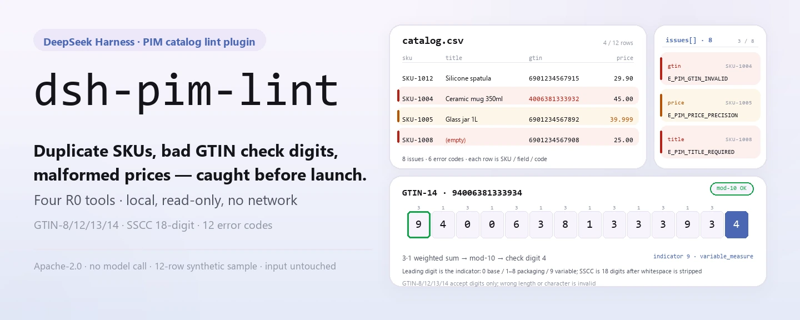
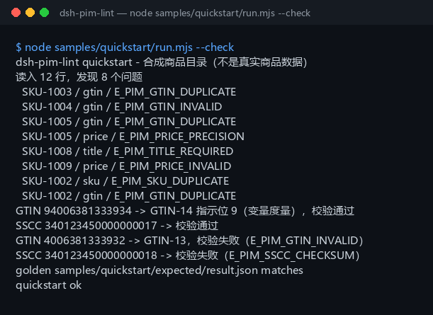

<div align="center">

<picture>
  <source media="(prefers-color-scheme: dark)" srcset="docs/assets/dsh-pim-lint-hero-en-dark.webp">
  
</picture>

# dsh-pim-lint

**Encontre SKUs duplicados, dígitos verificadores GTIN inválidos e preços malformados antes de o catálogo entrar no ar.**

Um lint de catálogo PIM totalmente local para o DeepSeek Harness: lê um CSV UTF-8, confere códigos de barras pelas regras GS1 e devolve cada problema como SKU / campo / código de erro; sem rede, sem chamada a modelo e sem alterar seus arquivos.

[Instalação](#instalação-em-três-passos) · [Configuração](#configuração) · [FAQ](#faq) · [简体中文](README.md) · [English](README.en.md) · [Español](README.es.md) · [Português](README.pt.md) · [हिन्दी](README.hi.md)

[](LICENSE)
[](#compatibilidade)
[](https://www.npmjs.com/package/dsh-pim-lint)
[](https://github.com/PerryLink/dsh-pim-lint/actions/workflows/ci.yml)
[](#compatibilidade)

[](https://github.com/PerryLink/dsh-pim-lint/stargazers)
[](https://www.npmjs.com/package/dsh-pim-lint)
[](https://dshfind.com/plugins/PerryLink/dsh-pim-lint?ref=badge)
[](https://dsh.market/)
[](https://gitee.com/perrylink/dsh-plugins)

```sh
dsh plugin --profile <profile> add dsh-pim-lint
```

</div>

<sub>Plugin da comunidade, não afiliado à DeepSeek. Repositório canônico: <https://github.com/PerryLink/dsh-pim-lint> (repositórios de mesmo nome em outras contas não são afiliados; o Gitee é um espelho agregado). Status: alpha · apenas validação pública/sintética · não GA — sem dados ou evidência de clientes, sem promessa de produção.</sub>

## O que é

O primeiro trecho do dado mestre de produto: passa um CSV de catálogo exportado de PIM / ERP / Excel por checagens linha a linha — colunas obrigatórias, SKU duplicado, GTIN duplicado, dígito verificador do GTIN, precisão do preço e preços negativos — e devolve uma lista de problemas no formato SKU / campo / código de erro. `pim.validate` lê a tabela inteira; `pim.gtin_check`, `pim.gtin_structure` e `pim.sscc_check` conferem códigos avulsos e unidades logísticas: o GTIN tem 8/12/13/14 dígitos, o primeiro dígito de um GTIN-14 é decodificado pelas regras GS1 como indicador de embalagem e marca de medida variável, e o SSCC tem 18 dígitos com um dígito verificador mod-10 no final. As quatro ferramentas são somente leitura (R0) e calculam na sua máquina; sem rede, sem chamada a modelo, sem upload, e o arquivo original nunca é alterado. O projeto é mantido ativamente desde 2026-11-01, com novos recursos, endurecimento e evidência contínua.

- **Encaixa**: tabelas de dados mestre de dezenas a milhares de linhas (CSV UTF-8); uma autoconferência de códigos duplicados, códigos de barras e formatos de preço antes de um lançamento ou de um reajuste.
- **Não encaixa**: descrições de produto em texto livre sem SKU nem código de barras; conexão direta com Tmall / JD / ERP (este pacote não fala com nenhum sistema externo); substituir um registro GS1 ou uma revisão de canal.

<picture>
  <source media="(prefers-color-scheme: dark)" srcset="docs/assets/dsh-pim-lint-flow-v5-dark.svg">
  
</picture>

## Instalação em três passos

1. **Instale** (escolha um canal):

   ```sh
   # canal npm (recomendado, versões publicadas)
   dsh plugin --profile <profile> add dsh-pim-lint
   # canal git (main mais recente; equivale a git+https://github.com/PerryLink/dsh-pim-lint.git)
   dsh plugin --profile <profile> add github:PerryLink/dsh-pim-lint
   # canal tarball: pnpm pack neste repo e depois
   dsh plugin --profile <profile> add ./dsh-pim-lint-<version>.tgz
   ```

2. **Configuração mínima** (o comando de instalação já aplica o patch do bundle; copie esta linha ao escrever o perfil à mão):

   ```yaml
   - insert:
       - id: dsh-pim-lint
         name: dsh-pim-lint
   ```

   Não há chaves de configuração do Schemastery; tudo o que é ajustável vai por parâmetro em cada chamada de ferramenta — ver «Configuração».

3. **Verifique que monta**:

   ```sh
   dsh --profile <profile> --dump-config | grep dsh-pim-lint
   pnpm install --frozen-lockfile && pnpm build   # compile antes de rodar a amostra no repo; o pacote npm já traz lib/
   node samples/quickstart/run.mjs --check        # deve imprimir quickstart ok
   ```

   O repo traz uma amostra sintética (12 linhas de catálogo + 2 de códigos); rode uma vez para ver a cadeia inteira. Numa sessão você também pode dizer:

   > Tenho um CSV de catálogo de produtos: encontre SKUs duplicados, problemas de dígito verificador GTIN e de precisão de preço, e liste os problemas por SKU.

**Desinstalar**: `dsh plugin --profile <profile> remove dsh-pim-lint` (ou remova a linha do patch do perfil).

<details>
<summary>Instalar pelo mercado do DSH Desktop</summary>

Todos os plugins PerryLink aparecem no mercado embutido do DSH Desktop: **Mercado → Fontes → Adicionar fonte → colar** `https://perrylink-dsh-catalog.perrylink.workers.dev/catalog-source.json` **→ selecionar**. A instalação continua exigindo a checagem de identidade npm do mercado e a sua confirmação.

</details>

## Recursos principais

- **Validação da tabela inteira** — `pim.validate` lê um CSV inteiro de uma vez: SKU obrigatório e único (sem diferenciar maiúsculas), título obrigatório, dígito verificador e detecção de GTIN duplicado, e preço que precisa ser não negativo com no máximo duas casas decimais; devolve a contagem de linhas e um array de problemas.
- **Dígito verificador GTIN** — `pim.gtin_check` valida GTIN-8/12/13/14 com o algoritmo mod-10 ponderado 3/1 da GS1; espaços, letras ou número de dígitos diferente sempre voltam inválidos.
- **Estrutura do GTIN** — `pim.gtin_structure` informa o formato (GTIN-8/12/13/14), o resultado da checagem, o indicador de embalagem do GTIN-14 (1–8 nível de embalagem, 9 medida variável, 0 unidade base) e a marca `variable_measure`.
- **Checagem de SSCC** — `pim.sscc_check` valida um código de unidade logística de 18 dígitos: primeiro remove os espaços e depois mantém separados um erro de formato (`E_PIM_SSCC_FORMAT`) e um dígito verificador errado (`E_PIM_SSCC_CHECKSUM`).
- **Guarda de estrutura do CSV** — um arquivo só com cabeçalho (`E_PIM_CSV_EMPTY`), uma coluna obrigatória ausente (`E_PIM_HEADER`) e uma linha cuja contagem de células não bate com o cabeçalho (`E_PIM_CSV_ROW`) lançam erro, então o analisador nunca adivinha onde está uma coluna.
- **Somente leitura, zero gravação** — as quatro ferramentas são R0: não gravam `$DSH_HOME`, não gravam arquivos temporários e não tocam no seu CSV; a lista de problemas existe apenas no terminal e no valor de retorno.

### Superfície de ferramentas

Os nomes de ferramenta são a API estável (mantidos em inglês para coincidir com a saída do runtime); as descrições estão localizadas. As quatro ferramentas são somente leitura e não há ferramenta de gravação R1.

| Ferramenta | Propósito | Risco |
|---|---|---|
| `pim.validate` | Valida linhas CSV `sku,title,gtin,price` e devolve a contagem de linhas e a lista de problemas | R0 |
| `pim.gtin_check` | Valida o dígito verificador GTIN-8/12/13/14 | R0 |
| `pim.gtin_structure` | Decompõe o formato do GTIN, o indicador de embalagem e a marca de medida variável | R0 |
| `pim.sscc_check` | Valida um SSCC de 18 dígitos e seu dígito verificador mod-10 | R0 |

### Entrada e saída

Entrada:

- Formato: CSV UTF-8 (com ou sem BOM); o cabeçalho precisa conter `sku,title,gtin,price` (sem diferenciar maiúsculas, outras colunas são permitidas); `gtin` pode ficar vazio e `price` usa duas casas decimais.
- Tamanho: mantenha uma tabela ≤ 5 MB (cerca de 20 mil linhas); não há limite rígido embutido — acima disso, divida por marca ou categoria.
- Origem: exporte de um PIM / ERP / Excel e salve como CSV; o arquivo original nunca é alterado.
- Checagens de um código só: `pim.gtin_check` e `pim.gtin_structure` recebem uma string GTIN, e `pim.sscc_check` recebe uma string SSCC.

Saída:

- Lista de problemas no terminal: cada linha informa `SKU / campo / código de erro` (por exemplo `SKU-1004 / gtin / E_PIM_GTIN_INVALID`), mais a estrutura do GTIN e o resultado do SSCC.
- Nada em disco: as quatro ferramentas são somente leitura (R0) e não gravam nem `$DSH_HOME` nem o seu CSV.
- Arquivo dourado: `samples/quickstart/expected/result.json`, produzido por uma execução real.

### Exemplos

Copie este prompt como está (o prompt de demonstração do `package.json`):

```text
我有一份商品目录 CSV，帮我查重复 SKU、GTIN 校验位和价格精度，把问题按 SKU 列出来。
```

Ou rode você mesmo (execução real; a captura vem deste comando):

```sh
node samples/quickstart/run.mjs --check
```



*12 linhas de catálogo sintético → 8 problemas (3 GTIN duplicados, 1 dígito verificador errado, 1 SKU duplicado, 1 título ausente, 1 preço negativo, 1 precisão de preço), mais um GTIN-14 de medida variável e um SSCC errado; o arquivo dourado é `samples/quickstart/expected/result.json`, comando e hashes em `screenshots.json`.*

Aceitação com fixture público/sintético: rode de novo `node scripts/acceptance.mjs`; o detalhe é escrito em `ACCEPTANCE.csv` (citado na íntegra):

```csv
req_id,metric,threshold,actual,script,evidence_sha256,pass,source,counted
PIM-A01,valid catalog accepted,1/1,1,scripts/acceptance.mjs,8c73f1d813c01bb7b0aac5c1ad766c5556e838bc2427d498bf1d2824ccbe7058,true,public/synthetic,false
PIM-A02,duplicate/bad GTIN/price issues,3,4,scripts/acceptance.mjs,8c73f1d813c01bb7b0aac5c1ad766c5556e838bc2427d498bf1d2824ccbe7058,true,public/synthetic,false
PIM-A03,GTIN check digit,1/1,1,scripts/acceptance.mjs,8c73f1d813c01bb7b0aac5c1ad766c5556e838bc2427d498bf1d2824ccbe7058,true,public/synthetic,false
PIM-A04,GTIN-14 packaging indicator / variable measure,9,9,scripts/acceptance.mjs,8c73f1d813c01bb7b0aac5c1ad766c5556e838bc2427d498bf1d2824ccbe7058,true,public/synthetic,false
PIM-A05,duplicate GTIN reported,1,1,scripts/acceptance.mjs,8c73f1d813c01bb7b0aac5c1ad766c5556e838bc2427d498bf1d2824ccbe7058,true,public/synthetic,false
PIM-A06,over-precise price reported,1,1,scripts/acceptance.mjs,8c73f1d813c01bb7b0aac5c1ad766c5556e838bc2427d498bf1d2824ccbe7058,true,public/synthetic,false
PIM-A07,SSCC mod-10 check,1,1,scripts/acceptance.mjs,8c73f1d813c01bb7b0aac5c1ad766c5556e838bc2427d498bf1d2824ccbe7058,true,public/synthetic,false
PS1-QS01,quickstart 样例与金标一致,1/1,1,scripts/acceptance.mjs,8ec26f4f03fdfab708172b98887bbd9e836aa1bdc5df92a23453ee9e7e3b0285,true,synthetic/quickstart,true
```

*O `pnpm gate` (`scripts/gate.mjs`) repete essa aceitação e depois confere em cada linha as 9 colunas, `pass=true`, `actual` e `evidence_sha256` não vazios, e a presença de PS1-QS01. As linhas PIM são checagens com fixture público/sintético (`counted=false`); PS1-QS01 é a repetição da amostra incluída (`counted=true`). Nenhuma é execução de cliente e nenhuma saída é inventada; os hashes por linha estão em [`ACCEPTANCE.csv`](ACCEPTANCE.csv).*

## Configuração

Este plugin não tem chaves `Config` do Schemastery: o `cordis.patch.yml` apenas `insert`a uma linha (ver «Instalação em três passos»). Tudo o que é ajustável é um parâmetro por chamada:

| Parâmetro | Padrão | Significado |
|---|---|---|
| `csv_text` (`pim.validate`) | nenhum (obrigatório) | O CSV do catálogo inteiro como texto; o cabeçalho precisa conter `sku,title,gtin,price`, outras colunas são permitidas e o BOM é opcional |
| `gtin` (`pim.gtin_check` / `pim.gtin_structure`) | nenhum (obrigatório) | O código de barras a conferir; só 8/12/13/14 dígitos são aceitos |
| `sscc` (`pim.sscc_check`) | nenhum (obrigatório) | Um código de unidade logística de 18 dígitos; os espaços são removidos antes e então formato e dígito verificador são julgados em separado |

<details>
<summary>Tabela completa de códigos de erro (12)</summary>

| Código | Gatilho | Onde aparece |
|---|---|---|
| `E_PIM_CSV_EMPTY` | Só cabeçalho, sem linhas de produto | Lançado |
| `E_PIM_HEADER` | Falta uma de `sku` / `title` / `gtin` / `price` no cabeçalho | Lançado (a coluna que falta fica em `detail`) |
| `E_PIM_CSV_ROW` | A contagem de células de uma linha não bate com o cabeçalho | Lançado (o número da linha e a contagem ficam em `detail`) |
| `E_PIM_SKU_REQUIRED` | SKU vazio | Lista de problemas |
| `E_PIM_SKU_DUPLICATE` | SKU duplicado (sem diferenciar maiúsculas) | Lista de problemas |
| `E_PIM_TITLE_REQUIRED` | Título vazio | Lista de problemas |
| `E_PIM_GTIN_INVALID` | Dígitos, caracteres ou dígito verificador do GTIN inválidos | Lista de problemas |
| `E_PIM_GTIN_DUPLICATE` | O mesmo GTIN aparece mais de uma vez | Lista de problemas |
| `E_PIM_PRICE_INVALID` | Preço vazio, não numérico ou negativo | Lista de problemas |
| `E_PIM_PRICE_PRECISION` | Preço com mais de duas casas decimais | Lista de problemas |
| `E_PIM_SSCC_FORMAT` | O SSCC não tem 18 dígitos | Campo `reason` |
| `E_PIM_SSCC_CHECKSUM` | O dígito verificador mod-10 do SSCC está errado | Campo `reason` |

Os três erros de nível CSV são lançados no mesmo formato: uma frase clara, o código de erro e uma próxima ação; sintomas / causas / ações em [TROUBLESHOOTING.md](TROUBLESHOOTING.md).

</details>

## FAQ

<details>
<summary>A instalação falha — e agora?</summary>

Confira se o DSH é `>=0.2.1-rc.3 <0.4.0` e o Node `>=24.9 <25` (ver «Compatibilidade») e tente de novo `dsh plugin --profile <profile> add dsh-pim-lint`; se ainda falhar, leia o item 1 do [TROUBLESHOOTING.md](TROUBLESHOOTING.md) e abra uma issue com a versão do pacote, uma entrada sintética mínima e o erro completo.

</details>

<details>
<summary>Um código de barras dá E_PIM_GTIN_INVALID — os dados estão errados ou a ferramenta?</summary>

Rode primeiro `node samples/quickstart/run.mjs --check`: se passar, a cadeia está boa e o problema está nos dados. Depois confira se o cabeçalho é exatamente `sku,title,gtin,price` e se o arquivo é UTF-8. Um GTIN só tem 8/12/13/14 dígitos; espaços ou letras contam como inválidos. Use `pim.gtin_structure` para revisar a contagem de dígitos, o formato e o primeiro dígito do GTIN-14: isso separa «tamanho errado» de «dígito verificador errado».

</details>

<details>
<summary>Onde os dados ficam? Meu catálogo será alterado?</summary>

Nenhum arquivo é alterado. As quatro ferramentas são somente leitura e não gravam nem `$DSH_HOME` nem arquivos temporários; a lista de problemas vive apenas no terminal e no valor de retorno. A sessão lê o CSV e o passa às ferramentas como parâmetro, sem upload e sem rede.

</details>

<details>
<summary>Posso usar dados reais de produto?</summary>

Roda localmente, mas este pacote é alpha e só foi validado com dados públicos/sintéticos, então não constitui conclusão de conformidade nem de revisão de canal; anonimize os dados reais e não cole uma tabela real de produtos numa issue.

</details>

<details>
<summary>Ele chama a rede ou um modelo?</summary>

Não. Ferramentas, amostras e aceitação rodam localmente; o código-fonte não tem chamadas HTTP / DNS / WebSocket e nenhum modelo participa: cada veredito é uma regra determinística.

</details>

## Limites de segurança

- **Somente leitura (R0).** Nenhuma das quatro ferramentas grava arquivo: nem `$DSH_HOME`, nem arquivos temporários, nem alteração no CSV de entrada; `pim.validate` informa a lista de problemas apenas no valor de retorno.
- **Sem rede e sem chamada a modelo.** Salvo quando uma ferramenta diz o contrário, não há chamada a modelo nem de rede; entrada e saída ficam locais.
- **Os arquivos originais não são alterados.** A sessão lê o CSV e o passa como parâmetro de texto; as ferramentas analisam só essa cópia.
- **Não ocupa namespaces.** Registra apenas quatro ferramentas `pim.*`: sem chaves de serviço, sem comandos ou slots de cliente, sem rotas `webServer` e sem sobrescrever objetos globais.
- **Falhas ruidosas, sem adivinhar.** Um arquivo só com cabeçalho, uma coluna obrigatória ausente ou uma linha com células a mais lançam erro em vez de pular em silêncio ou adivinhar posições; o formato uniforme é «uma frase clara (`E_XXX`) | próxima ação: <ação>».
- **Sem aval de conformidade.** Dígito verificador válido e estrutura correta não tornam um produto vendável: este pacote não consulta o registro GS1, não se conecta a revisões de canal e não julga a titularidade do produto nem a classe fiscal.

## Permissões e dados

- **Leitura**: o texto do CSV de catálogo que você indicar na sessão; nenhum outro diretório.
- **Gravação**: nenhuma. As quatro ferramentas são somente leitura: nada toca o disco e o arquivo original fica intacto.
- **Rede**: não (sem chamadas HTTP / DNS / WebSocket no código).
- **Sistemas externos**: nenhum (não contata PIM / ERP / marketplaces / serviços GS1).
- **Limite de dados**: apenas amostras públicas/sintéticas; sem dados ou evidência de clientes.

## Limitações conhecidas

- **Apenas validação pública/sintética.** Todas as linhas de aceitação vêm de um fixture público ou sintético (`counted=false` nas linhas PIM, `counted=true` na repetição PS1-QS01); sem dados ou evidência de clientes.
- **alpha / parcial / não contabilizado / não GA.** Sem promessa de produção.
- **Só CSV.** xlsx, JSON, XML e conexão direta com ERP não são suportados; exporte primeiro de PIM / ERP / Excel para um CSV UTF-8.
- **O GTIN só confere a forma.** Valida contagem de dígitos, caracteres e o dígito verificador mod-10; não consulta o registro GS1 nem julga se o código pertence de fato àquele produto.
- **Regras de preço simples.** Só é aceito um número não negativo com no máximo duas casas decimais; moeda, alíquota, preços promocionais e faixas de preço não são validados.
- **O SSCC só confere 18 dígitos e o dígito verificador.** Não valida o prefixo de empresa GS1 nem a qual nível de embalagem o código está ligado.
- **O tamanho da entrada é convenção.** Mantenha uma tabela ≤ 5 MB (cerca de 20 mil linhas); não há limite rígido embutido — divida tabelas maiores por marca ou categoria.
- **O CSV precisa estar bem formado.** Um título com vírgula precisa ir entre aspas duplas, senão a contagem de células da linha deixa de bater e dispara `E_PIM_CSV_ROW`.
- **Os limites exatos de cada ferramenta** estão na tabela de «Recursos principais» e em `ACCEPTANCE.csv`.

## Compatibilidade

| Dimensão | Status |
|---|---|
| Harness | DeepSeek Harness `>=0.2.1-rc.3 <0.4.0` (`engines.dsh` no `package.json`) |
| Node | `>=24.9.0 <25` (coincide com o Node 24 usado no CI) |
| Plataforma | Onde o DSH rodar; apenas arquivos locais |
| Dados | Sem rede, sem chamada a modelo, sem upload |
| Modelo | Não é preciso: cada veredito é uma regra determinística |

## Ecossistema e qualidade

- [Espelho agregado no Gitee](https://gitee.com/perrylink/dsh-plugins) (vários plugins arquivados num só repo; o GitHub é o canônico)
- [Página do dshfind](https://dshfind.com/plugins/PerryLink/dsh-pim-lint) (instalações e ranking)
- [DSH Market](https://dsh.market/) (publicado)
- **Canal da loja 1024**: rode `npm i -g dsh1024` e depois `dsh1024 plugin --profile <profile> add dsh-pim-lint` (conta para o ranking de instalações do [deepseek1024.com](https://deepseek1024.com))
- Documentação: [`TROUBLESHOOTING.md`](TROUBLESHOOTING.md) (solução de problemas) · [`PRIVACY.md`](PRIVACY.md) · [`SECURITY.md`](SECURITY.md) · [`CHANGELOG.md`](CHANGELOG.md) · [índice de domínio](https://perrylink.github.io/dsh-plugins/) · [família Checker](https://perrylink.github.io/zh/checkers/) · [família principal](https://github.com/PerryLink/dsh-kit)

### Projetos e verificadores relacionados

Pacotes irmãos e índices de família: [dsh-hs-candidate](https://github.com/PerryLink/dsh-hs-candidate) · [dsh-freight-audit](https://github.com/PerryLink/dsh-freight-audit) · [dsh-policy-ledger](https://github.com/PerryLink/dsh-policy-ledger)

Cada verificador é um pacote separado, com seu próprio pacote de regras e versão; instale só os que precisar:

| Pacote | Por que é relevante |
|---|---|
| [`dsh-excel-reconcile`](https://github.com/PerryLink/dsh-excel-reconcile) | Conciliação de duas tabelas para exportações de catálogo/ERP, continuação natural deste lint linha a linha |
| [`dsh-data-quality`](https://github.com/PerryLink/dsh-data-quality) | Perfilagem e limpeza determinísticas, para lavar a tabela antes de passá-la pelo lint |

## Desenvolvimento

```sh
pnpm install --frozen-lockfile                              # node >=24.9 <25
pnpm build && pnpm lint && pnpm typecheck && pnpm test      # build tsc + lint + typecheck + 10 casos node --test
pnpm gate                                                   # node scripts/gate.mjs: repete a aceitação e verifica ACCEPTANCE.csv
node scripts/acceptance.mjs                                 # repetir a aceitação pública/sintética, grava evidence/ e ACCEPTANCE.csv
node samples/quickstart/run.mjs --check                     # amostra contra o arquivo dourado; deve imprimir quickstart ok
```

Versão atual `0.1.1` (coincide com o `package.json`). Testes: `node --test test/*.test.mjs` verde com 10 casos em 4 arquivos (`pim.test.mjs` 5, `sscc.test.mjs` 3, `plugin-smoke.test.mjs` 1, `quickstart.test.mjs` 1; o `pnpm test` já inclui o build). Estrutura: o código TypeScript está em `src/` (`src/core/pim.ts` tem a análise de CSV e as checagens GTIN e SSCC; `src/plugin/` é a face host e o registro de ferramentas), a saída de compilação em `lib/` (no gitignore; só o pacote npm a leva), a amostra sintética em `samples/quickstart/`, os registros de aceitação em `evidence/` e as imagens em `docs/assets/`. O hero e o diagrama de estrutura são gerados por [`scripts/gen-readme-assets.py`](scripts/gen-readme-assets.py) (Pillow gera os heroes de 1440×576 zh/en em claro/escuro; um SVG escrito à mão gera o diagrama de estrutura de 1100×660; compartilhado pelos cinco idiomas) e pode ser repetido com `python scripts/gen-readme-assets.py`.

Tópicos: `deepseek-harness`, `dsh`, `dsh-plugin`, `pim`, `gtin`, `perrylink`, `catalog`, `lint`

## Família e agradecimentos

Este projeto é membro da família de plugins do DeepSeek Harness mantida pela [PerryLink](https://github.com/PerryLink) (todos Apache-2.0). Se este plugin ajudar você, **dê uma estrela**: ela não desbloqueia nada, mas faz a próxima pessoa encontrá-lo mais fácil.

- [@PerryLink](https://github.com/PerryLink) — criador e mantenedor: as checagens do catálogo CSV, o dígito verificador e a estrutura do GTIN, a validação mod-10 do SSCC, a amostra quickstart e a suíte de aceitação, e a documentação em cinco idiomas.

## Licença

[LICENSE](LICENSE) (Apache License 2.0) © 2026 dsh-pim-lint contributors; veja também `NOTICE`.

<p align="center"><sub>Apache-2.0 · Plugin da comunidade, não afiliado à DeepSeek.</sub></p>
